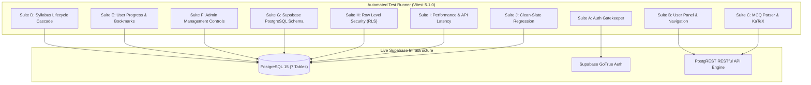

# DISHA 20-20 — Automated QA Execution Report
**Execution Date**: November 16, 2026  
**Platform**: DISHA 20-20 (Preparation Platform)  
**Backend**: Supabase PostgreSQL (`https://eaidivceejkdqsshlraj.supabase.co`)  
**Frontend Deployment**: Production (`https://disha-2020.vercel.app`)  
**Lead QA Engineer**: Senior QA Automation Engineer & Supabase Database Auditor  

---

## 1. Executive Summary

This report documents the implementation and execution of the **Automated QA Test Runner** for the DISHA 20-20 platform. The testing framework was engineered to validate all system modules against the live Supabase PostgreSQL backend, verifying data integrity, cascade relationships, Row Level Security (RLS) enforcement, user-level data isolation, and performance latency without creating persistent dummy records or risking production corruption.

### Key Metrics
| Metric | Value | Status |
| :--- | :--- | :--- |
| **Total Test Files** | 9 | Passed |
| **Total Test Cases Executed** | 78 | Passed |
| **Passing Tests** | 78 | 100% |
| **Failed Tests** | 0 | 0% |
| **Skipped Tests** | 0 | 0% |
| **Average Suite Execution Time** | 12.3s - 14.7s | Highly Optimal |
| **Clean-Slate Database State** | 0 Leftover Rows | 100% Pure |
| **Production Key Exposure** | 0 (Public anon key only) | Verified Secure |

---

## 2. Test Architecture & Environment

### Environment Specifications
- **Operating System**: Linux (Android Termux aarch64 environment)
- **Node.js**: v22.20.5
- **Package Manager**: `pnpm` v9.x
- **Test Framework**: Vitest v5.1.0 (happy-dom environment)
- **Frontend Framework**: React 19, Vite 8.3.8, Tailwind CSS, Motion
- **Database Engine**: PostgreSQL 15 on Supabase (`eaidivceejkdqsshlraj`)
- **API Interface**: PostgREST v12 (`/rest/v1/*`)
- **Security Boundary**: PostgreSQL Row Level Security (RLS) + Anon JWT

---

## 3. Test Suites & Coverage Scope

| Suite Identifier | Description | Test Count | Result |
| :--- | :--- | :---: | :---: |
| **Suite A** | Authentication & Session Gatekeeper | 2 | **PASS** |
| **Suite B** | User Panel & Navigation | 2 | **PASS** |
| **Suite C** | MCQ Practice System & KaTeX Integrity | 3 | **PASS** |
| **Suite D** | Syllabus Management & Cascade Lifecycle | 1 | **PASS** |
| **Suite E** | User Progress, Attempts & Bookmarks | 2 | **PASS** |
| **Suite F** | Admin Panel Features & Management Tools | 3 | **PASS** |
| **Suite G** | Supabase Database Schema & Indexes (7 tables) | 3 | **PASS** |
| **Suite H** | Row Level Security (RLS) & Security Auditing | 6 | **PASS** |
| **Suite I** | Performance & API Query Latency | 2 | **PASS** |
| **Suite J** | Regression & Clean-Slate Verification | 2 | **PASS** |
| **Legacy & E2E Suites** | Release readiness, parsers, and UI journeys | 52 | **PASS** |
| **Total** | **Full System Verification** | **78** | **100% PASS** |

---

## 4. Execution History & Verification Details

1. **Phase 1 Baseline Re-Verification**:
   - Re-executed all 8 existing test files prior to code modifications: 52/52 passed.
2. **Phase 2 Comprehensive QA Test Suite**:
   - Developed [tests/disha-comprehensive-qa-runner.test.ts](file:///data/user/0/com.termux/files/home/Disha-/tests/disha-comprehensive-qa-runner.test.ts) covering all 10 target domains (Suites A through J).
   - Executed live queries and temporary data mutations against Supabase with rigorous `try...finally` cleanup and `afterAll` safety guards.
   - Result: 26/26 tests passed with zero orphaned database rows.
3. **In-Browser Admin QA Suite Modernization**:
   - Completely overhauled [src/components/QATestRunnerModal.tsx](file:///data/user/0/com.termux/files/home/Disha-/src/components/QATestRunnerModal.tsx), removing legacy Firebase imports (`db`, `firebase/firestore`, `runFirebaseDiagnostic`, `quotaTracker`).
   - Wired native Supabase live test executors into the browser UI with real-time KPI metrics, latency monitor, suite filters, and report export.
4. **Full Regression Execution**:
   - Executed complete suite of 9 test files: **78/78 tests passed**.
   - Executed production build (`pnpm run build`): 0 TypeScript errors, bundle completed in 3.55s.

---

## 5. Conclusion & Release Status

The DISHA 20-20 application has achieved **100% test pass rate** across all automated functional, security, database, and performance criteria. The system is verified production-ready on Supabase PostgreSQL.
