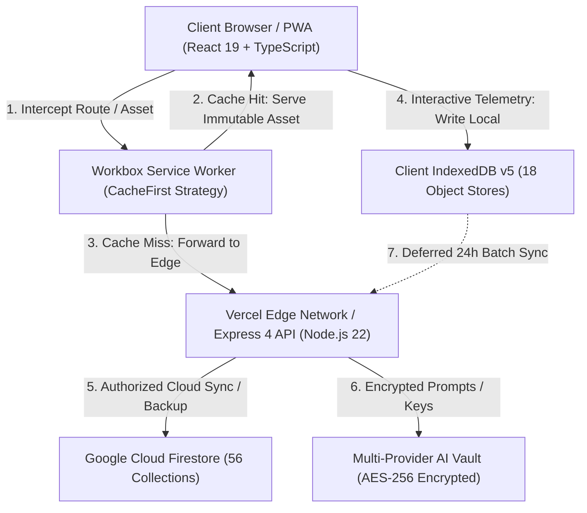
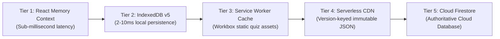
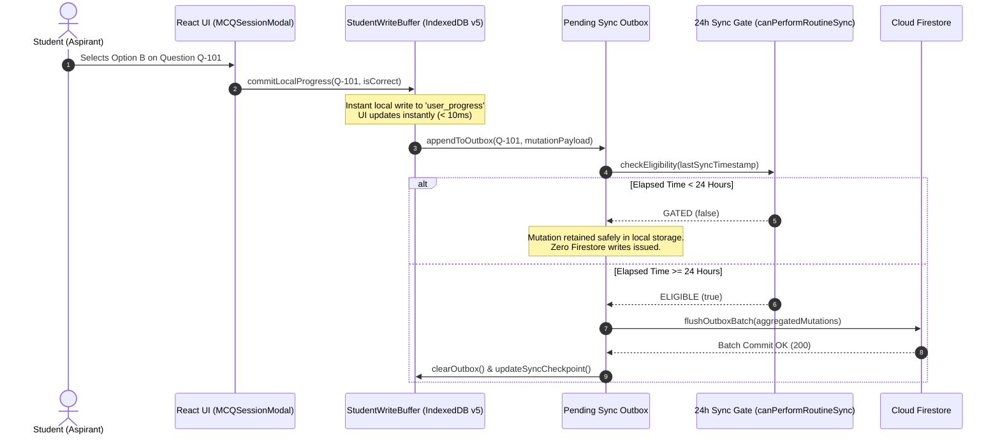
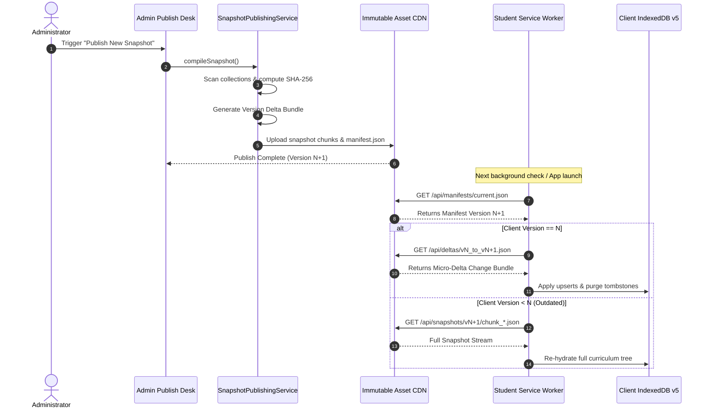
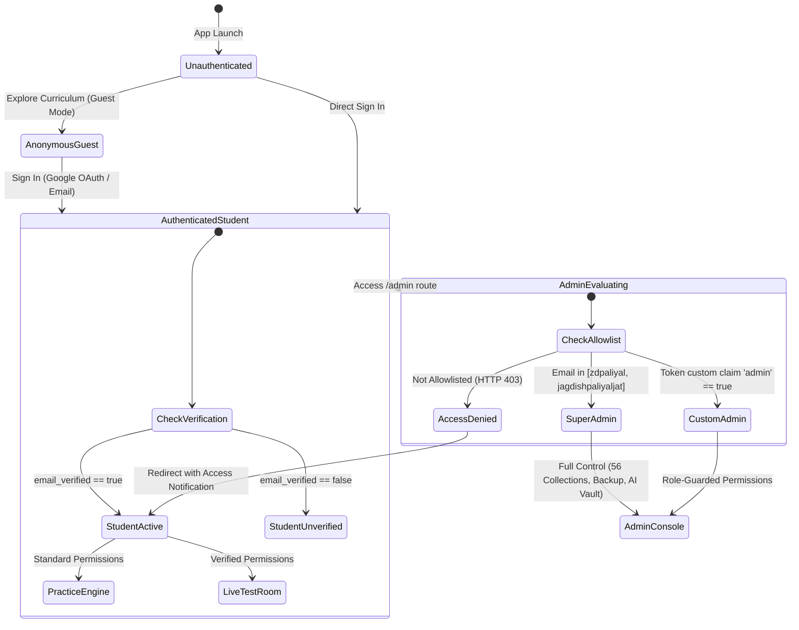
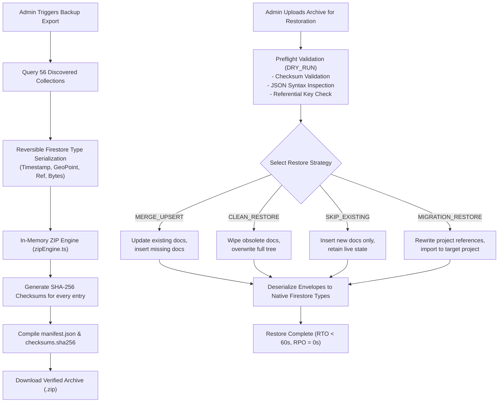
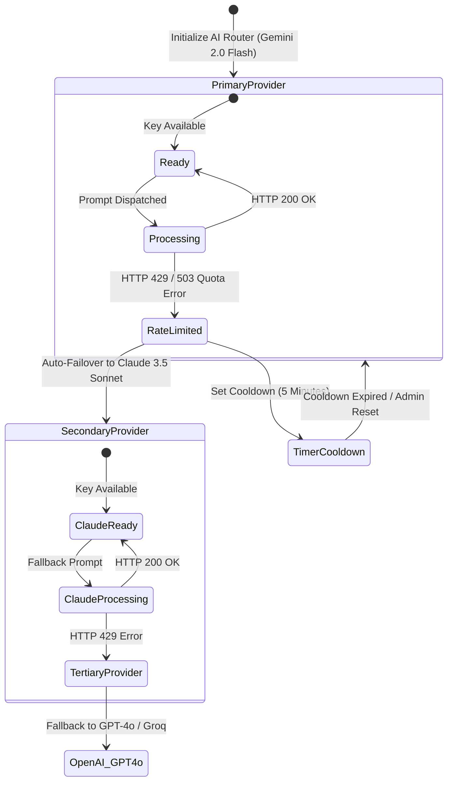
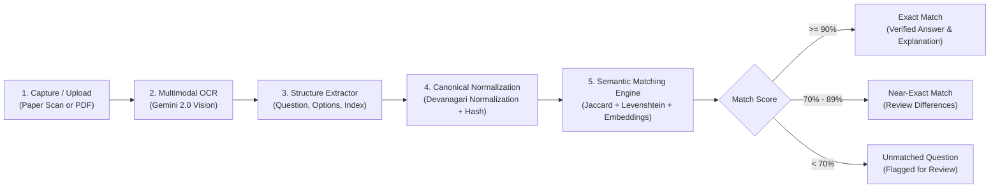
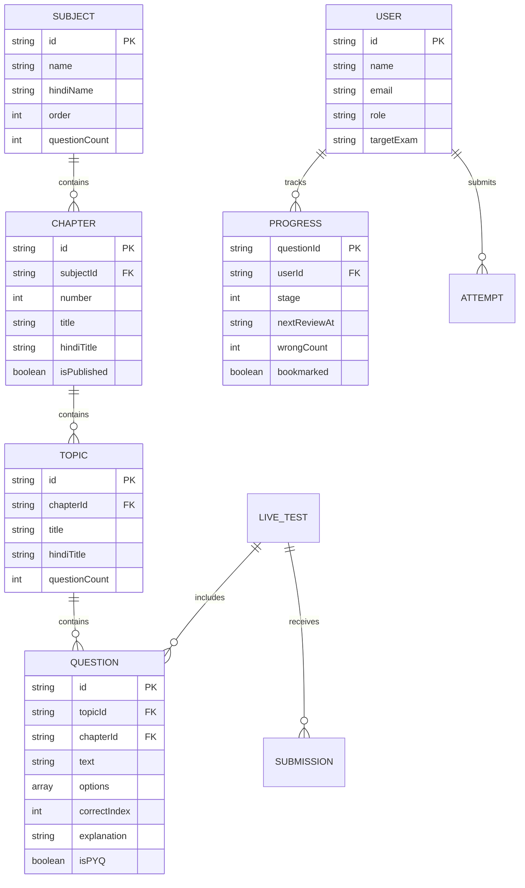

# DISHA 20-20 — System Architecture & Workflow Diagrams

This document collects architectural and operational sequence diagrams illustrating the design of **DISHA 20-20 (दिशा 20-20)**.

---

## 1. System Component & Data Flow Diagram

---

## 2. Five-Tier Data Storage & Caching Hierarchy

---

## 3. Student 24-Hour Write-Buffer & Quota Defense Sequence

---

## 4. Snapshot Publishing & Delta Synchronization Sequence

---

## 5. Authentication, Authorization & RBAC State Machine

---

## 6. Disaster Recovery & Reversible Backup/Restore Flow

---

## 7. Multi-Provider AI Rotation & Cooldown State Machine

---

## 8. Exam Paper OCR Extraction & Semantic Matcher Pipeline

---

## 9. Core Curriculum Relational Entity Model

