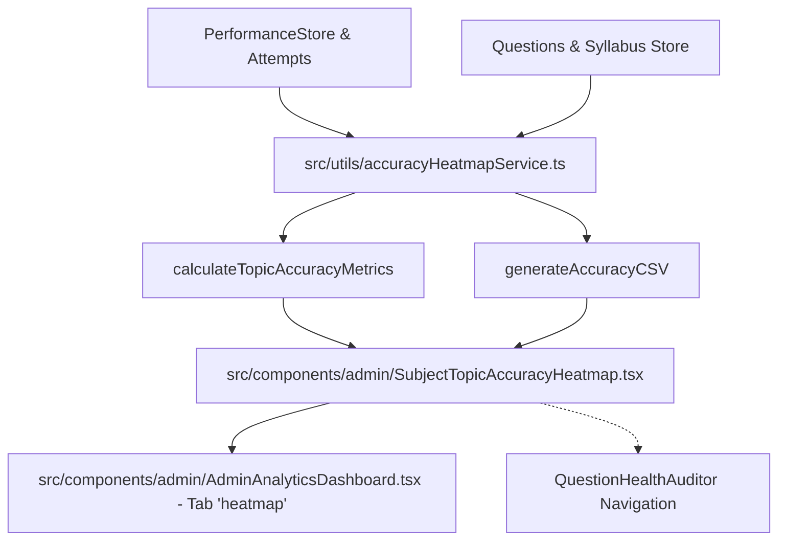

# Subject & Topic Accuracy Heatmap Implementation Plan

> **For agentic workers:** REQUIRED SUB-SKILL: Use superpowers:subagent-driven-development (recommended) or superpowers:executing-plans to implement this plan task-by-task. Steps use checkbox (`- [ ]`) syntax for tracking.

**Goal:** Build an enterprise-grade Subject & Topic Accuracy Heatmap & Content Quality Control Desk for Disha admins to monitor student performance, detect low-accuracy topics (<50%), audit question quality, and export syllabus reports.

**Architecture:** A pure TypeScript calculation engine (`accuracyHeatmapService.ts`) aggregates question performance metrics and cloud/local attempt telemetry by subject, chapter, and topic. The UI component (`SubjectTopicAccuracyHeatmap.tsx`) visualizes these metrics with KPI summary cards, interactive filters (Subject, Health Tier, Search, Sort), color-coded accuracy meters, and CSV export, mounted as a dedicated tab in `AdminAnalyticsDashboard.tsx` with deep-linking to `QuestionHealthAuditor`.

**Architecture Diagram:**



**Tech Stack:** React 19, TypeScript, Lucide Icons, Vitest, Tailwind CSS.

**Spec:** `docs/superpowers/specs/2026-11-24-subject-topic-accuracy-heatmap-design.md`

## Global Constraints
- Target platform: Android WebView / Capacitor PWA and modern Web.
- Package manager: `pnpm` exclusively.
- No new system packages (`pkg`/`apt`) or external dependencies without permission.
- Temporary files must use `$TMPDIR`.
- All tests must pass with `pnpm vitest run`.
- TypeScript strictness: zero errors on `pnpm exec tsc --noEmit`.

## Review Focus
1. Handling empty attempts: If a topic has 0 student attempts, accuracy percentage must not produce `NaN` or divide-by-zero errors; it should gracefully show 0% or fallback baseline.
2. Health tier classification: Exactly `< 50%` is `critical`, `50% - 70%` is `moderate`, and `> 70%` is `healthy`.
3. Safe CSV export: Proper escaping of quotes, commas, and Hindi unicode characters in topic and chapter names.
4. Search & filter resilience: Filter by subject, health status, and text search simultaneously without crashing on undefined topic names.
5. Integration non-breaking: Adding the `"heatmap"` tab to `AdminAnalyticsDashboard.tsx` must preserve existing `"website"` and `"students"` tab functionality.

---

### Task 1: Accuracy Heatmap Core Service & Unit Tests

**Files:**
- Create: `src/utils/accuracyHeatmapService.ts`
- Test: `tests/accuracy-heatmap.test.ts`

**Interfaces:**
- Produces:
  ```typescript
  export type HealthTier = 'critical' | 'moderate' | 'healthy';
  export interface TopicAccuracyMetric {
    topicId: string;
    topicName: string;
    chapterId: string;
    chapterName: string;
    subjectId: string;
    subjectName: string;
    totalQuestions: number;
    totalAttempts: number;
    correctAttempts: number;
    wrongAttempts: number;
    accuracyPercentage: number;
    avgTimeSeconds: number;
    healthTier: HealthTier;
  }
  export interface AccuracyHeatmapSummary {
    overallAccuracy: number;
    totalTopics: number;
    criticalCount: number;
    moderateCount: number;
    healthyCount: number;
    totalAttempts: number;
    metrics: TopicAccuracyMetric[];
  }
  export function calculateTopicAccuracyMetrics(
    subjects: any[],
    chapters: any[],
    perfStore?: Record<string, any>,
    attemptLogs?: any[]
  ): AccuracyHeatmapSummary;
  export function exportAccuracyHeatmapCSV(metrics: TopicAccuracyMetric[]): string;
  ```

- [ ] **Step 1: Write the failing test**
  Create `tests/accuracy-heatmap.test.ts` with tests for:
  - Tier determination: `<50%` critical, `50-70%` moderate, `>70%` healthy.
  - Zero attempt division-by-zero protection (`accuracyPercentage` is 0, never `NaN`).
  - Aggregation across multiple questions within the same topic.
  - CSV export formatting and header row inclusion.

- [ ] **Step 2: Run test to verify it fails**
  Run: `pnpm vitest run tests/accuracy-heatmap.test.ts`
  Expected: FAIL with "module not found" or "calculateTopicAccuracyMetrics is not defined".

- [ ] **Step 3: Implement `src/utils/accuracyHeatmapService.ts`**
  - Implement `classifyHealthTier(accuracy: number): HealthTier`.
  - Implement `calculateTopicAccuracyMetrics(...)`: Iterates over subjects, chapters, and topics, aggregates attempt counts and correct counts, computes percentages rounded to 1 decimal place, calculates overall summary KPIs, and sorts critical topics first by default.
  - Implement `exportAccuracyHeatmapCSV(metrics: TopicAccuracyMetric[]): string`.

- [ ] **Step 4: Run test to verify it passes**
  Run: `pnpm vitest run tests/accuracy-heatmap.test.ts`
  Expected: PASS all tests.

- [ ] **Step 5: Commit**
  ```bash
  git add src/utils/accuracyHeatmapService.ts tests/accuracy-heatmap.test.ts
  git commit -m "feat(analytics): add topic accuracy heatmap aggregation service"
  ```

---

### Task 2: Subject & Topic Accuracy Heatmap UI Component

**Files:**
- Create: `src/components/admin/SubjectTopicAccuracyHeatmap.tsx`

**Interfaces:**
- Consumes:
  - `calculateTopicAccuracyMetrics`, `exportAccuracyHeatmapCSV`, `TopicAccuracyMetric`, `AccuracyHeatmapSummary` from `src/utils/accuracyHeatmapService.ts`
  - `loadUserQuestionsStore`, `getCombinedSubjects`, `getCombinedChapters` from `src/utils/questionsStorage.ts`
  - `loadPerformanceStore` from `src/utils/performanceStorage.ts`
- Produces:
  ```typescript
  export interface SubjectTopicAccuracyHeatmapProps {
    onInspectTopic?: (topicId: string, chapterId: string) => void;
    className?: string;
  }
  export const SubjectTopicAccuracyHeatmap: React.FC<SubjectTopicAccuracyHeatmapProps>;
  ```

- [ ] **Step 1: Implement `SubjectTopicAccuracyHeatmap.tsx`**
  - KPI summary row: Overall Accuracy gauge, Total Topics, Critical Review Topics badge, High Mastery Topics badge.
  - Controls bar: Subject dropdown, Health tier filter buttons (All, 🔴 Critical, 🟡 Moderate, 🟢 Healthy), Search input, Sort selector (Lowest Accuracy, Highest Attempts, Most Questions), Refresh and CSV Download buttons.
  - Heatmap card grid: Responsive cards displaying subject/chapter breadcrumb, topic name, progress bar color-coded by tier (Rose-500, Amber-500, Emerald-500), stats pills (Attempts, Questions, Avg Time), and "Review Questions" action button.
  - Empty state when filters return no matches.

- [ ] **Step 2: Verify component compiles**
  Run: `pnpm exec tsc --noEmit`
  Expected: Zero TypeScript errors.

- [ ] **Step 3: Commit**
  ```bash
  git add src/components/admin/SubjectTopicAccuracyHeatmap.tsx
  git commit -m "feat(admin): create SubjectTopicAccuracyHeatmap component"
  ```

---

### Task 3: Integration into `AdminAnalyticsDashboard.tsx` & `AdminTab.tsx`

**Files:**
- Modify: `src/components/admin/AdminAnalyticsDashboard.tsx`
- Modify: `src/components/AdminTab.tsx`

**Interfaces:**
- Updates `activeSection` state in `AdminAnalyticsDashboard.tsx` to include `"heatmap"`:
  ```typescript
  const [activeSection, setActiveSection] = React.useState<"students" | "website" | "heatmap">("website");
  ```
- Adds Heatmap navigation tab with flame/target icon in the dashboard sub-navigation header.
- Connects "Review Questions" in heatmap to switch active view or notify admin.

- [ ] **Step 1: Edit `AdminAnalyticsDashboard.tsx`**
  - Add third sub-tab: `"heatmap"` labelled "Accuracy Heatmap" / "Content Quality".
  - Render `<SubjectTopicAccuracyHeatmap />` when `activeSection === "heatmap"`.

- [ ] **Step 2: Verify build and component interaction**
  Run: `pnpm exec tsc --noEmit`
  Expected: Success without errors.

- [ ] **Step 3: Commit**
  ```bash
  git add src/components/admin/AdminAnalyticsDashboard.tsx
  git commit -m "feat(admin): integrate Accuracy Heatmap into AdminAnalyticsDashboard"
  ```

---

### Task 4: Full App Build & Test Suite Verification

**Files:**
- Test: All tests including `tests/accuracy-heatmap.test.ts`
- Build: `pnpm run build`
- Android Sync: `pnpm run cap:copy` or copy to `android/app/src/main/assets/public/`

- [ ] **Step 1: Run complete test suite**
  Run: `pnpm vitest run tests/accuracy-heatmap.test.ts tests/version-control-force-update.test.ts`
  Expected: All tests PASS.

- [ ] **Step 2: Run production build**
  Run: `pnpm run build`
  Expected: Vite build succeeds with `dist/` updated.

- [ ] **Step 3: Sync to Android assets**
  Run: `cp -r dist/* android/app/src/main/assets/public/`
  Expected: Assets mirrored cleanly.

- [ ] **Step 4: Final Git Commit**
  ```bash
  git status
  git commit -m "chore: sync production build assets for Accuracy Heatmap desk"
  ```
