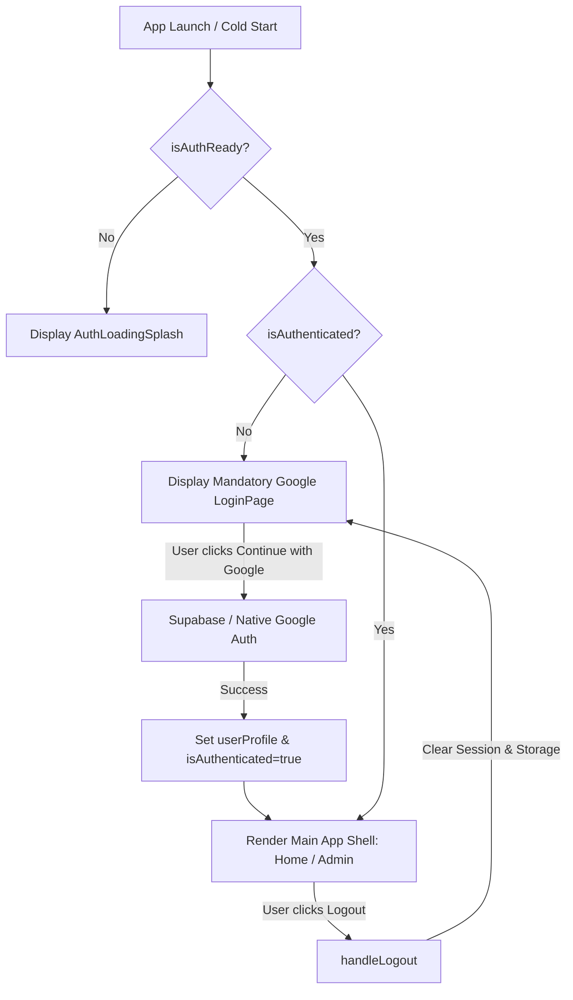

# Mandatory Google Login Gate Implementation Plan

> **For agentic workers:** REQUIRED SUB-SKILL: Use superpowers:subagent-driven-development (recommended) or superpowers:executing-plans to implement this plan task-by-task. Steps use checkbox (`- [ ]`) syntax for tracking.

**Goal:** Ensure the Disha PYQ app displays exclusively the Google Login screen on launch until authentication completes, preventing any unauthenticated access to tabs, syllabus, exams, or admin portals.

**Architecture:** Implement a strict root-level authentication gate in `App.tsx`. While initializing the session, display an branded `AuthLoadingSplash`. If unauthenticated, render the full-screen `LoginPage` without close/bypass buttons. Only upon verified Google Sign-In or validated persistent session does the main app shell (Header, Content, BottomNav) render. Logout terminates session and returns directly to the login gate.

**Architecture Diagram:**

**Tech Stack:** React 19, Vite, TypeScript, Supabase Auth (Google OAuth & Native One-Tap), Capacitor Android

**Spec:** [2026-11-25-mandatory-google-login-gate-spec.md](file:///data/user/0/ai.antigem/files/home/projects/Disha-/docs/superpowers/plans/2026-11-25-mandatory-google-login-gate-spec.md)

## Global Constraints
- Only Google Sign-In is allowed for authentication.
- No guest bypass allowed: unauthenticated users cannot view questions, mock tests, or syllabus.
- Must preserve active session on restart (auto-login without re-prompting logged-in users).
- Must pass `pnpm build` (`vite build`) and vitest unit tests.

## Review Focus
1. Cold start flash: Ensure no flash of Home screen before auth check completes.
2. Back button handling on Android: Ensure Android hardware back button does not escape login screen.
3. Logout redirect: Verify logging out clears all credentials and snaps immediately back to login screen.
4. Auto-redirect on successful sign-in: Ensure student goes to `home` and admin goes to `admin` tab.

---

### Task 1: Update `LoginPage.tsx` for Strict Mandatory Google Login
- [ ] Add `isMandatory?: boolean` prop to `LoginPageProps`.
- [ ] When `isMandatory` is `true`, do not render the "Close" button in the top bar.
- [ ] Keep the prominent "Continue with Google" button, high-conversion feature highlights, and Legal/Privacy links.
- [ ] Verify `LoginPage.tsx` compiles with zero TypeScript errors.

### Task 2: Implement Root-Level Auth Gating & Splash in `App.tsx`
- [ ] Create an `AuthLoadingSplash` component in `App.tsx` (or dedicated helper) with the app logo, spinner, and loading text.
- [ ] In `App.tsx`, return `AuthLoadingSplash` while `!isAuthReady`.
- [ ] If `!isAuthenticated` or `!isProfileAuthenticated(userProfile)`, return `<LoginPage isMandatory={true} onLoginSuccess={...} />`.
- [ ] Ensure `handleLogout` sets `isAuthenticated(false)` and `setUserProfile(null)` so unauthenticated state is immediately enforced.
- [ ] Ensure hardware back button listener does not dismiss the login gate.

### Task 3: Unit Tests & Build Verification
- [ ] Write/update vitest tests in `tests/mandatory-login-gate.test.ts` verifying:
  - Unauthenticated profiles are recognized by `isProfileAuthenticated`.
  - Auth gate blocks unauthorized access.
  - Logout cleanly unsets credentials and triggers unauthenticated status.
- [ ] Run `pnpm test` on the auth test suite.
- [ ] Run `pnpm build` to verify the production bundle.
