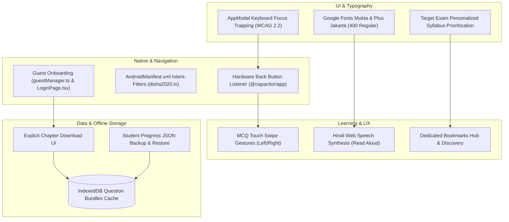

# Comprehensive App Improvements Implementation Plan

> **For agentic workers:** REQUIRED SUB-SKILL: Use superpowers:subagent-driven-development (recommended) or superpowers:executing-plans to implement this plan task-by-task. Steps use checkbox (`- [ ]`) syntax for tracking.

**Goal:** Implement all 12 critical improvements identified in the audit to enhance Android APK native stability, student learning experience, offline readiness, data protection, typography, and accessibility across Disha 20-20.

**Architecture:** 
1. **Mobile Native Layer:** Wire `@capacitor/app` hardware back button listener into a unified modal/navigation stack manager, update `AndroidManifest.xml` with `disha2020.in` deep link intent-filters, and unlock guest exploration in `LoginPage.tsx`.
2. **Student Learning & UX Layer:** Add touch swipe navigation (`onTouchStart`/`onTouchEnd`) and Hindi Web Speech API text-to-speech to `MCQSessionModal.tsx`, and elevate bookmark discovery with a dedicated hub.
3. **Data & Offline Layer:** Expose explicit "Download for Offline" controls in `TopicsTab.tsx` backed by IndexedDB caching, and add full JSON data backup/restore in `AppSettingsModal.tsx`.
4. **Typography & Accessibility Layer:** Load `wght@400` in Google Fonts, prioritize target exam subjects on Home/Topics tabs, and enforce keyboard focus trapping in `AppModal.tsx`.

**Architecture Diagram:**

**Tech Stack:** React 19, TypeScript, Vite, Tailwind CSS, Capacitor 6, IndexedDB (`localforage`), Web Speech API, Vitest.

**Spec:** Identified audit findings covering Native Android stability, Student UX, Offline capability, Data protection, Typography, and Accessibility.

## Global Constraints
- Target platform: Android (Capacitor) & Web PWA.
- Termux environment: no root, no sudo, `$TMPDIR` for temporary files.
- Package manager: `pnpm`.
- Preserve existing data schemas, clean slate logic, and test coverage.

## Review Focus
1. Hardware back button must close top-most active modal/drawer without accidentally closing the whole application.
2. Guest mode must allow unauthenticated users to browse subjects and practice questions without losing data when signing in later.
3. Touch swipe gestures in MCQ session must not trigger on accidental vertical scrolls.
4. Offline chapter downloads must persist into IndexedDB and reflect visual downloaded state.
5. Student JSON backup must cleanly serialize bookmarks, reason tags, notes, and test attempts, and validate schema before restoring.

---

### Task 1: Native Android Stability (Hardware Back Button, Deep Links & Guest Mode)

**Files:**
- Modify: `src/App.tsx`
- Modify: `src/components/LoginPage.tsx`
- Modify: `android/app/src/main/AndroidManifest.xml`
- Modify: `capacitor.config.ts`
- Test: `tests/native-stability.test.tsx`

**Interfaces:**
- Consumes: `@capacitor/app` (`CapacitorApp.addListener('backButton')`), `src/utils/guestManager.ts` (`isGuestSession`, `saveGuestAttemptLocally`).
- Produces: Global back-button stack handler, guest sign-in bypass, verified deep linking for `https://disha2020.in`.

- [ ] **Step 1: Write unit tests for Hardware Back Button and Guest Mode in `tests/native-stability.test.tsx`**
  - Verify back button prioritizes closing active modal, then closing drawer, then navigating back.
  - Verify `LoginPage` renders "Continue as Guest" button when `isMandatory` or native platform is active, and invokes guest initialization.

- [ ] **Step 2: Run test to verify it fails**
  - Run: `pnpm test tests/native-stability.test.tsx`
  - Expected: FAIL

- [ ] **Step 3: Implement Hardware Back Button listener in `src/App.tsx`**
  - Import `App as CapacitorApp` from `@capacitor/app`.
  - In a `useEffect`, register `CapacitorApp.addListener('backButton', ({ canGoBack }) => { ... })`.
  - If a modal is open (`activeSession`, `isLoginOpen`, `isSettingsOpen`, `isSearchOpen`, etc.), close it.
  - If `isDrawerOpen` is true, close it.
  - If `activeTab !== 'home'`, switch to `'home'`.
  - If on `'home'` root, trigger a double-tap toast notification ("Press back again to exit") or call `CapacitorApp.exitApp()`.

- [ ] **Step 4: Update `android/app/src/main/AndroidManifest.xml` & `capacitor.config.ts` for `disha2020.in`**
  - Add `<intent-filter>` with `<data android:scheme="https" android:host="disha2020.in" />` and `<data android:scheme="https" android:host="www.disha2020.in" />`.
  - In `capacitor.config.ts`, add `disha2020.in` and `www.disha2020.in` to `server.allowNavigation`.

- [ ] **Step 5: Add "Continue as Guest" button to `src/components/LoginPage.tsx`**
  - Add an accessible button: "बिना लॉगिन जारी रखें (Continue as Guest)".
  - When clicked, create a guest profile (`id: "guest"`, `name: "Guest Student"`, `email: ""`) and trigger `onLoginSuccess`.

- [ ] **Step 6: Run test to verify it passes**
  - Run: `pnpm test tests/native-stability.test.tsx`
  - Expected: PASS

- [ ] **Step 7: Commit Task 1**
  - Run: `git add tests/native-stability.test.tsx src/App.tsx src/components/LoginPage.tsx android/app/src/main/AndroidManifest.xml capacitor.config.ts && git commit -m "feat(native): add hardware back button handler, deep links for disha2020.in, and guest onboarding"`

---

### Task 2: Student Learning UX (Swipe Gestures, Hindi TTS & Bookmarks Hub)

**Files:**
- Modify: `src/components/MCQSessionModal.tsx`
- Modify: `src/components/BottomNav.tsx`
- Modify: `src/components/WrongTab.tsx`
- Modify: `src/components/HomeTab.tsx`
- Test: `tests/student-learning-ux.test.tsx`

**Interfaces:**
- Consumes: `window.speechSynthesis`, Touch Events (`onTouchStart`, `onTouchEnd`).
- Produces: Horizontal swipe navigation between MCQs, Hindi audio read-aloud button, clear Bookmarks hub in navigation.

- [ ] **Step 1: Write unit tests in `tests/student-learning-ux.test.tsx`**
  - Test horizontal touch gesture (swipe left -> next question, swipe right -> prev question, ignoring vertical swipes).
  - Test Hindi Text-to-Speech trigger for question text.
  - Test Bookmarks quick filter and dedicated view state.

- [ ] **Step 2: Run test to verify it fails**
  - Run: `pnpm test tests/student-learning-ux.test.tsx`
  - Expected: FAIL

- [ ] **Step 3: Implement touch swipe gestures in `src/components/MCQSessionModal.tsx`**
  - Add `touchStartX` and `touchStartY` refs.
  - On `onTouchStart`, record initial `clientX` and `clientY`.
  - On `onTouchEnd`, compare `deltaX` and `deltaY`. If `Math.abs(deltaX) > 50` and `Math.abs(deltaX) > Math.abs(deltaY) * 1.5`, trigger Next (swipe left) or Previous (swipe right).

- [ ] **Step 4: Implement Hindi Read-Aloud (Text-to-Speech) in `src/components/MCQSessionModal.tsx`**
  - Add a speaker button beside the question header.
  - Use `window.speechSynthesis` with `SpeechSynthesisUtterance`, setting `lang = 'hi-IN'` and reading question text and options cleanly, with play/stop toggle.

- [ ] **Step 5: Enhance Bookmarks Hub Visibility**
  - In `src/components/HomeTab.tsx`: Add a dedicated 1-tap "Saved Bookmarks (स्मार्ट बुकमार्क)" quick-card with reason tag badges directly on the home screen.
  - In `src/components/WrongTab.tsx`: Add a prominent segmented control toggle between "गलत प्रश्न (Mistakes)" and "बुकमार्क (Saved Bookmarks)" so students can switch between them with 1 tap.

- [ ] **Step 6: Run test to verify it passes**
  - Run: `pnpm test tests/student-learning-ux.test.tsx`
  - Expected: PASS

- [ ] **Step 7: Commit Task 2**
  - Run: `git add tests/student-learning-ux.test.tsx src/components/MCQSessionModal.tsx src/components/WrongTab.tsx src/components/HomeTab.tsx && git commit -m "feat(ux): add swipe gesture navigation, hindi tts read-aloud, and prominent bookmarks hub"`

---

### Task 3: Offline Study & Student Data Backup

**Files:**
- Modify: `src/components/TopicsTab.tsx`
- Modify: `src/components/AppSettingsModal.tsx`
- Modify: `src/components/ProfileTab.tsx`
- Modify: `src/utils/indexedDbCache.ts`
- Test: `tests/offline-and-backup.test.tsx`

**Interfaces:**
- Consumes: `saveCachedQuestionBundle`, `getCachedQuestionBundle`, `loadProgressFromStorage`, `saveProgressToStorage`.
- Produces: "Download for Offline" button per chapter with status indicator, JSON export & import of student study progress.

- [ ] **Step 1: Write unit tests in `tests/offline-and-backup.test.tsx`**
  - Verify offline bundle pre-fetch and cached status check.
  - Verify student progress export serializes bookmarks, notes, and history into valid JSON.
  - Verify restore backup validates JSON schema before overwriting local state.

- [ ] **Step 2: Run test to verify it fails**
  - Run: `pnpm test tests/offline-and-backup.test.tsx`
  - Expected: FAIL

- [ ] **Step 3: Add "Download for Offline" UI in `src/components/TopicsTab.tsx`**
  - For each chapter/topic, check if it is cached in IndexedDB via `getCachedQuestionBundle`.
  - Render a download button / "Downloaded (ऑफलाइन उपलब्ध)" checkmark.
  - Clicking download fetches questions from the API or local bundle and saves to IndexedDB with visual success feedback.

- [ ] **Step 4: Implement Student Progress JSON Backup & Restore in `src/components/AppSettingsModal.tsx` and `src/components/ProfileTab.tsx`**
  - Add "Export Backup (JSON)" button: gathers bookmarks, reason tags, question notes, custom tags, and attempt history into a formatted JSON blob and downloads it with timestamp (`disha2020-backup-YYYY-MM-DD.json`).
  - Add "Restore Backup (JSON)" button: provides a file input to upload previously saved backup, validates data integrity, restores to localStorage/IndexedDB, and refreshes the context.

- [ ] **Step 5: Run test to verify it passes**
  - Run: `pnpm test tests/offline-and-backup.test.tsx`
  - Expected: PASS

- [ ] **Step 6: Commit Task 3**
  - Run: `git add tests/offline-and-backup.test.tsx src/components/TopicsTab.tsx src/components/AppSettingsModal.tsx src/components/ProfileTab.tsx src/utils/indexedDbCache.ts && git commit -m "feat(storage): add explicit chapter offline downloads and student progress json backup/restore"`

---

### Task 4: Typography, Target Exam Personalization & Modal Focus Trap

**Files:**
- Modify: `index.html`
- Modify: `src/components/HomeTab.tsx`
- Modify: `src/components/TopicsTab.tsx`
- Modify: `src/components/ui/AppModal.tsx`
- Test: `tests/typography-and-a11y.test.tsx`

**Interfaces:**
- Consumes: Google Fonts Mukta & Plus Jakarta Sans, `userProfile?.targetExam`.
- Produces: Regular 400 font weight rendering, exam-relevant topic prioritization, accessible modal focus trapping.

- [ ] **Step 1: Write unit tests in `tests/typography-and-a11y.test.tsx`**
  - Verify `index.html` contains `wght@400` for Mukta.
  - Verify `TopicsTab` and `HomeTab` sort/badge subjects matching `userProfile?.targetExam`.
  - Verify `AppModal` intercepts `Tab` / `Shift+Tab` to trap focus inside the dialog.

- [ ] **Step 2: Run test to verify it fails**
  - Run: `pnpm test tests/typography-and-a11y.test.tsx`
  - Expected: FAIL

- [ ] **Step 3: Update `index.html` font links**
  - Include `Mukta:wght@400;500;600;700;800` and `Plus+Jakarta+Sans:wght@400;500;600;700;800`.

- [ ] **Step 4: Add Target Exam Content Prioritization in `src/components/HomeTab.tsx` and `src/components/TopicsTab.tsx`**
  - If `userProfile?.targetExam` is set (e.g. "REET", "RAS", "CET", "Police"), highlight and prioritize subjects matching that exam category with a badge "🎯 आपके लक्ष्य के लिए अनुशंसित".

- [ ] **Step 5: Implement Keyboard Focus Trap in `src/components/ui/AppModal.tsx`**
  - When modal is open, listen to `keydown` for `Tab` key.
  - Cycle focus between the first and last focusable elements (`button, [href], input, select, textarea, [tabindex]:not([tabindex="-1"])`).

- [ ] **Step 6: Run test to verify it passes**
  - Run: `pnpm test tests/typography-and-a11y.test.tsx`
  - Expected: PASS

- [ ] **Step 7: Commit Task 4**
  - Run: `git add tests/typography-and-a11y.test.tsx index.html src/components/HomeTab.tsx src/components/TopicsTab.tsx src/components/ui/AppModal.tsx && git commit -m "feat(ui): add 400 regular font weight, target exam topic prioritization, and modal focus trap"`
