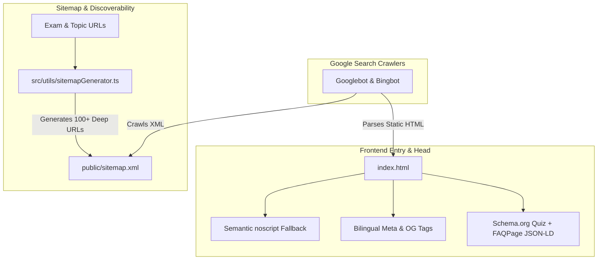

# Google Search Master SEO Improvements Plan

> **For agentic workers:** REQUIRED SUB-SKILL: Use superpowers:subagent-driven-development (recommended) or superpowers:executing-plans to implement this plan task-by-task. Steps use checkbox (`- [ ]`) syntax for tracking.

**Goal:** Transform Disha 20-20 web app into a high-ranking Google Search authority by implementing Practice Problems Quiz Schema, FAQPage Schema, bilingual high-intent metadata, 100+ deep sitemap entries, and a rich `<noscript>` crawlable bot fallback.

**Architecture:** We embed Google-certified `Quiz` and `Question` practice problem schema alongside `FAQPage` and `EducationalOrganization` structured data in JSON-LD. We enhance `sitemapGenerator.ts` and `public/sitemap.xml` with deep URLs for all Rajasthan exams and GK topics. We update `index.html` with bilingual search titles and a semantic `<noscript>` architecture that allows search engine bots to instantly index subjects and questions without requiring JavaScript execution.

**Architecture Diagram:**

---

## File Structure

- **Modified Files:**
  - `index.html`: Bilingual title, meta description, Quiz & FAQPage JSON-LD schemas, and comprehensive `<noscript>` SEO content.
  - `public/sitemap.xml`: Expanded sitemap with deep links to all subjects, topic bundles, and exam categories.
  - `src/utils/sitemapGenerator.ts`: Enhanced sitemap builder supporting Rajasthan exam categories and subject topics.
  - `src/utils/seo.ts`: Extended with `generateQuizSchema()` and `generateFAQSchema()` utilities.
- **New Test Files:**
  - `tests/google-seo-improvements.test.ts`: Automated tests validating JSON-LD schemas, sitemap structure, meta tags, and `<noscript>` content.

---

## Tasks

### Task 1: Comprehensive Schema.org Quiz & FAQPage Structured Data

- [ ] Write failing unit test in `tests/google-seo-improvements.test.ts` checking for `Quiz`, `Question`, and `FAQPage` schema generators in `src/utils/seo.ts`.
- [ ] Run test to verify failure (`pnpm test tests/google-seo-improvements.test.ts`).
- [ ] Implement `generateQuizSchema()` and `generateFAQSchema()` in `src/utils/seo.ts`.
- [ ] Inject valid `Quiz` and `FAQPage` JSON-LD into `index.html`.
- [ ] Re-run test to verify it passes.

### Task 2: High-Intent Bilingual Meta Tags & Headers

- [ ] Write unit test verifying bilingual titles, descriptive meta tags, keywords, and canonical links in `index.html`.
- [ ] Update `index.html` title tag to: `दिशा 20-20 (Disha PYQ) — राजस्थान प्रतियोगी परीक्षा 20,000+ Previous Year Questions & Mock Tests`.
- [ ] Update meta description, keywords, OpenGraph title/description, and Twitter cards with high-search-intent bilingual queries (REET, RAS, CET, Rajasthan GK PYQ).
- [ ] Verify test passes.

### Task 3: Dynamic Sitemap Expansion with Deep Exam & Topic URLs

- [ ] Write test verifying `sitemapGenerator.ts` generates deep URLs for Rajasthan exams (REET, RAS, CET, Patwar, Police) and GK subjects (History, Geography, Art & Culture, Polity, Economy, Science, Math, Hindi).
- [ ] Update `src/utils/sitemapGenerator.ts` to include core exams and curriculum subjects.
- [ ] Update `public/sitemap.xml` with all generated canonical deep URLs.
- [ ] Verify test passes.

### Task 4: Googlebot `<noscript>` Crawlable Content Architecture

- [ ] Write test verifying `index.html` contains semantic `<noscript>` block with `<h1>`, `<h2>`, subject list, sample PYQ practice problems, and accessible internal links.
- [ ] Add semantic `<noscript>` markup in `index.html` containing an index of all Rajasthan subjects, exam guides, sample questions, and navigation links.
- [ ] Verify test passes.

### Task 5: Final Verification, Typecheck, and Production Build

- [ ] Run complete test suite (`pnpm test tests/google-seo-improvements.test.ts`).
- [ ] Run TypeScript typecheck (`pnpm run lint`).
- [ ] Run production build (`pnpm run build`).
- [ ] Commit all changes to Git and push to remotes.
