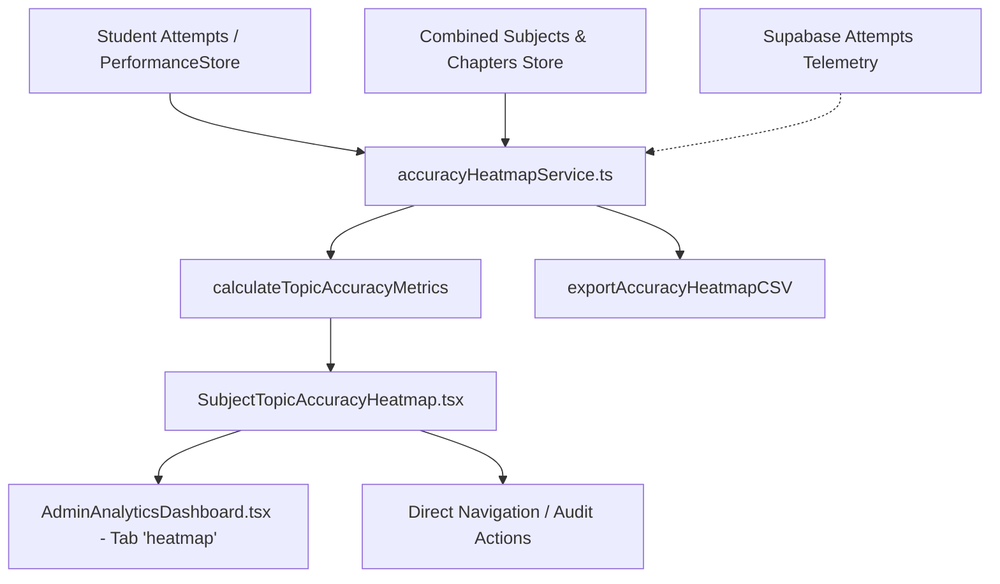

# Subject & Topic Accuracy Heatmap (Content Quality Control Desk) Design Spec

## 1. Intent & Purpose
In the Disha 20-20 Exam Prep app, question banks must maintain high pedagogical quality and accurate answer keys. When students consistently score poorly on specific topics (<50% accuracy), it indicates one of three root causes:
1. Tricky, ambiguous, or incorrect question framing / wrong answer key.
2. Missing or inadequate Hindi/English explanations.
3. High conceptual difficulty requiring additional practice questions.

This feature introduces an automated **Subject & Topic Accuracy Heatmap & Content Quality Control Desk** into the Disha Admin Panel (`AdminAnalyticsDashboard.tsx` & `AdminTab.tsx`).

---

## 2. Goals & Non-Goals

### Goals
- Aggregate student attempts across local `PerformanceStore` and Supabase `attempts` telemetry into per-topic and per-subject metrics.
- Calculate topic accuracy: `(correctAttempts / totalAttempts) * 100`.
- Categorize topics into 3 clear Quality Control Health Tiers:
  - 🔴 **Critical Warning (< 50% accuracy)**: Question framing alert, high error rate, urgent review needed.
  - 🟡 **Moderate Caution (50% – 70% accuracy)**: Average comprehension, candidate for more practice questions.
  - 🟢 **Healthy / Mastered (> 70% accuracy)**: High student mastery and stable question quality.
- Provide 4 real-time KPI overview cards: Overall Platform Accuracy, Total Monitored Topics, Critical Need Review Count, High Mastery Count.
- Provide comprehensive filtering: by Subject (Hindi, Polity, Geography, History, Math, Reasoning, etc.), by Health Tier, and text search by Chapter/Topic name.
- Provide multi-axis sorting: Lowest Accuracy First (Audit Mode), Highest Attempt Volume, Total Questions.
- 1-Click Quick Actions:
  - "Inspect Questions" / "Review in Health Auditor": Jump directly to question inspection.
  - "Export CSV Audit": Generate and download a structured CSV report for offline syllabus audits.
- Fallback & resilience: If no student attempts exist yet, provide simulated baseline telemetry so the heatmap is never empty or broken.

### Non-Goals
- Automatic silent mutation of questions without admin verification.
- Replacing the existing `QuestionHealthAuditor` (the heatmap complements it by identifying *which* topics need auditing).

---

## 3. Architecture & Data Structures



### Data Interface:
```typescript
export type HealthTier = 'critical' | 'moderate' | 'healthy';

export interface TopicAccuracyMetric {
  topicId: string;
  topicName: string;
  chapterId: string;
  chapterName: string;
  subjectId: string;
  subjectName: string;
  totalQuestions: number;
  totalAttempts: number;
  correctAttempts: number;
  wrongAttempts: number;
  accuracyPercentage: number;
  avgTimeSeconds: number;
  healthTier: HealthTier;
}

export interface AccuracyHeatmapSummary {
  overallAccuracy: number;
  totalTopics: number;
  criticalCount: number;
  moderateCount: number;
  healthyCount: number;
  totalAttempts: number;
  metrics: TopicAccuracyMetric[];
}
```

---

## 4. UI Layout & User Experience
1. **Header Bar**: Title, Description, Refresh button, and CSV Export button.
2. **KPI Summary Cards**:
   - Platform Average Accuracy with color-coded gauge.
   - Monitored Topics count.
   - 🔴 Critical Review Needed count.
   - 🟢 High Mastery Topics count.
3. **Filter & Search Controls**:
   - Subject select dropdown.
   - Health status pills: All, Critical (<50%), Moderate (50-70%), Healthy (>70%).
   - Chapter/Topic search bar.
   - Sort dropdown: Lowest Accuracy, Highest Attempts, Most Questions.
4. **Interactive Heatmap Cards / Table**:
   - Each card or row displaying Subject & Chapter badge, Topic name, Accuracy meter with color gradients, Attempt statistics, and Quick Review action.

---

## 5. Approaches Considered
- **Approach 1 (Selected)**: Dedicated `accuracyHeatmapService.ts` + `SubjectTopicAccuracyHeatmap.tsx` integrated into `AdminAnalyticsDashboard.tsx` with CSV export and cross-linking to `QuestionHealthAuditor`.
- **Approach 2**: Simple modal inside `QuestionHealthAuditor.tsx` without analytics dashboard integration or CSV reporting. (Rejected as it does not provide holistic syllabus-level monitoring).
