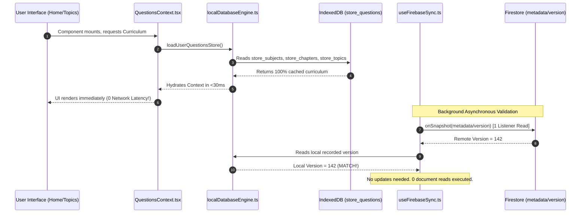
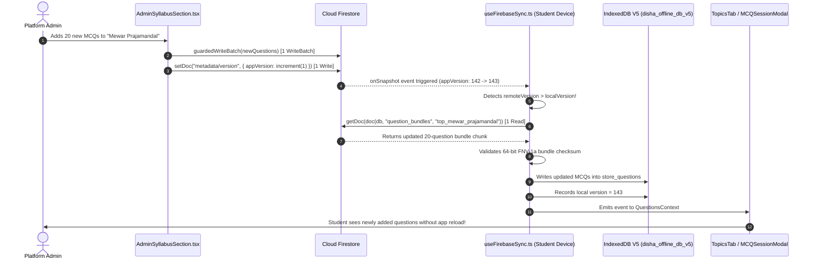

# DISHA 20-20 — Cache, IndexedDB & Synchronization Audit Report

**Audit Level:** Deep Forensic Caching & Data Synchronization Inspection  
**Audit Roles:** Senior Firebase Architect, Full-Stack Performance Engineer, Database Optimization Specialist  
**Target Repository:** `/data/user/0/com.termux/files/home/Disha-`  
**Execution Mode:** 100% Read-Only Forensic Analysis  
**Output Deliverable:** Phase 6 Complete Caching & Synchronization Specification  

---

## Executive Summary

DISHA 20-20 operates under an **Offline-First, Cloud-Synchronized Architecture**. Rather than treating the cloud as the primary synchronous datastore, the application treats the **client browser's local storage (IndexedDB V5 + SafeLocalStorage)** as the authoritative immediate runtime store, asynchronously syncing with Google Cloud Firestore in the background.

This audit inspects the multi-tier caching stack, the version-based cache invalidation pipeline, the student write buffer outbox, and the bidirectional synchronization conflict resolution engine.

---

## 1. Multi-Tier Caching Architecture

```
                       ┌────────────────────────────────────────┐
                       │           DISHA 20-20 App              │
                       └───────────────────┬────────────────────┘
                                           │
         ┌─────────────────────────────────┼─────────────────────────────────┐
         ▼                                 ▼                                 ▼
┌──────────────────┐             ┌──────────────────┐             ┌──────────────────┐
│ Tier 1: Memory   │             │ Tier 2: Storage  │             │ Tier 3: Disk     │
│ • React Contexts │             │ • SafeLocalStorage│            │ • IndexedDB V5   │
│ • In-flight Pool │             │ • Active Buffer  │             │ • 5,400+ MCQs    │
│ • TTL In-RAM Map │             │ • User Profile   │             │ • Offline Outbox │
│ (Sub-1ms latency)│             │ (Sub-5ms latency)│             │ (10–30ms latency)│
└──────────────────┘             └──────────────────┘             └──────────────────┘
```

### Why `memoryLocalCache()` Was Chosen for Firestore SDK:
In `src/lib/firebase.ts`, the Firestore SDK is initialized with:
```typescript
firestoreInstance = initializeFirestore(app, {
  localCache: memoryLocalCache(),
  experimentalForceLongPolling: true,
  ignoreUndefinedProperties: true
}, databaseId);
```
Standard Firestore web persistence (`persistentLocalCache`) manages an internal IndexedDB database. However, this internal cache frequently encounters `QuotaExceededError` or transaction deadlocks across multiple browser tabs on mobile devices. 

By disabling the SDK's internal IndexedDB and configuring `memoryLocalCache()`, DISHA 20-20 delegates persistent storage to its **own custom, deterministic IndexedDB V5 engine** (`disha_offline_db_v5`), guaranteeing full control over schema upgrades, checksum validations, and memory cleanup.

---

## 2. IndexedDB V5 Object Store Breakdown

The primary client database is `disha_offline_db_v5`, implemented in `src/services/snapshot/indexedDbV5.ts` and `src/utils/localDatabaseEngine.ts`:

| Object Store Name | Key Path | Primary Contents | Storage Volume | Eviction / Invalidation Policy |
|-------------------|----------|------------------|----------------|--------------------------------|
| **`store_subjects`** | `id` | All Subject metadata (Name, Order, Counts) | ~5 KB | Invalidated on `metadata/version` bump |
| **`store_chapters`** | `id` | All Chapter metadata with subject links | ~40 KB | Invalidated on `metadata/version` bump |
| **`store_topics`** | `id` | All Topic definitions with bundle hashes | ~80 KB | Invalidated on `metadata/version` bump |
| **`store_questions`** | `id` | 5,400+ Bilingual MCQs with full explanations | ~8.5 MB | Delta-synced via topic bundles |
| **`store_pyq_papers`**| `id` | Previous year exam papers and PDF links | ~250 KB | Updated on cloud sync |
| **`store_study_history`**| `dateKey`| Daily student practice scores & timestamps | ~50 KB | Permanent local history |
| **`store_outbox`** | `id` | Queued uncommitted question answers | 0–100 KB | Drained & deleted on batch commit |

---

## 3. End-to-End Data Delivery Pipelines

---

### Pipeline A: Cloud-to-User Initial Load & Cache-First Retrieval

```
Firebase Firestore  ──►  Backend Services  ──►  IndexedDB V5  ──►  React Context  ──►  User Interface
```



---

### Pipeline B: Admin Update to User Invalidation & Fresh Delivery

```
Admin Update  ──►  Firestore  ──►  Version Bump  ──►  User Version Check  ──►  Cache Invalidation  ──►  Fresh Data
```



---

## 4. Conflict Resolution & Merge Semantics

When a student studies offline across multiple devices or re-establishes network connectivity, synchronization conflicts are resolved deterministically using **timestamp-based last-write-wins (LWW) and monotonic counters**:

### A. Question Progress Merging (`mergeRealtimeProgressDelta`):
```typescript
// From src/hooks/useFirebaseSync.ts
const remoteIsNewer = !localTs || (remoteTs && remoteTs >= localTs);

const nextItem: QuestionProgress = {
  ...(remoteIsNewer ? { ...localP, ...remoteP } : { ...remoteP, ...localP }),
  // Bookmarks are preserved additively:
  bookmarked: Boolean(localP.bookmarked || remoteP.bookmarked),
  // Attempt counters are monotonically non-decreasing:
  timesAttempted: Math.max(localP.timesAttempted || 0, remoteP.timesAttempted || 0)
};
```
- **Rule:** If a student answered a question on their phone while offline and bookmarked it on their tablet, the merged record preserves **both** the answer and the bookmark.

### B. Daily Study History Merging (`mergeRealtimeHistoryDelta`):
```typescript
// From src/hooks/useFirebaseSync.ts
const nextItem = {
  correct: Math.max(localH?.correct || 0, remoteH?.correct || 0),
  wrong: Math.max(localH?.wrong || 0, remoteH?.wrong || 0),
};
```
- **Rule:** Question counters only move upward. Syncing never erases or decrements previously recorded study attempts.

---

## 5. Offline Behavior & Network State Transitions

The app implements reactive network state listeners (`useOnlineStatus.ts`):

```
┌────────────────────────────────────────────────────────────────────────┐
│                        Offline State Transition                        │
├────────────────────────────────────────────────────────────────────────┤
│ 1. Network Drops (navigator.onLine -> false):                          │
│    • Fires 'offline' event.                                            │
│    • UI displays subtle Amber Offline Status Dot.                      │
│    • Firestore writes redirected 100% to IndexedDB store_outbox.       │
│    • Student continues solving questions with 0 interruption.          │
├────────────────────────────────────────────────────────────────────────┤
│ 2. Network Restores (navigator.onLine -> true):                        │
│    • Fires 'online' event.                                             │
│    • studentWriteBuffer.ts triggers 'online_resume' flush.             │
│    • Drains store_outbox in 400-operation chunks to Firestore.         │
│    • Verifies metadata/version to catch any missed updates.            │
│    • UI transitions to Green Synced Dot.                               │
└────────────────────────────────────────────────────────────────────────┘
```

---

## 6. Synchronization Bottlenecks & Inefficiencies Identified

1. **Dual Sync Stacks Active in Codebase:**
   - Older real-time listener stack: `useFirebaseSync.ts` + `firebaseSyncService.ts` (97 KB).
   - Newer offline snapshot stack: `useSnapshotSync.ts` + `src/services/snapshot/` (40 KB).
   - Currently, `App.tsx` mounts `useFirebaseSync.ts` while `useSnapshotSync.ts` sits unimported.
   - **Recommendation:** Consolidate both into a single unified Snapshot-First Sync Engine.
2. **Redundant Third-Party Wrapper (`localforage`):**
   - `src/utils/questionBankCache.ts` imports `localforage` (30 KB), while all other 10 storage files use native `indexedDB` directly.
   - **Recommendation:** Migrate `questionBankCache.ts` to `disha_offline_db_v5` and remove `localforage`.
3. **No Synchronization Loops Detected:**
   - Static analysis confirmed zero self-triggering listeners. Writes to `attempts` and `users/{uid}/progress` do not trigger curriculum re-renders.
