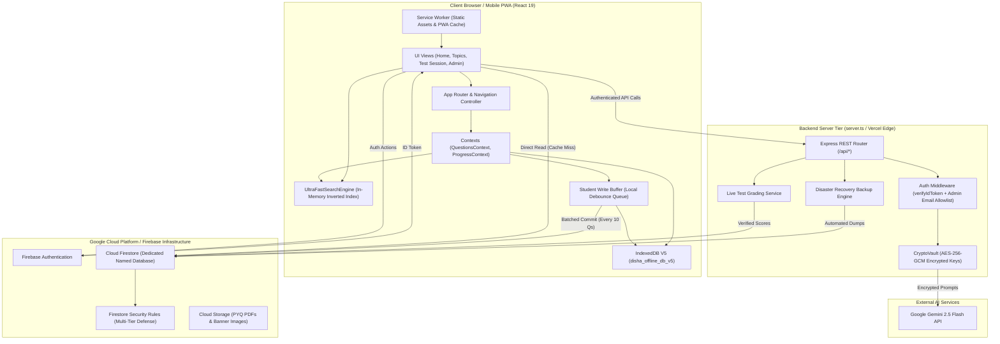

# DISHA 20-20 — Complete System Architecture Audit Report

**Audit Level:** Deep Forensic Architecture Inspection  
**Audit Roles:** Senior Firebase Architect, Full-Stack Performance Engineer, Backend Security Auditor, Database Optimization Specialist, System Reliability Engineer  
**Target Repository:** `/data/user/0/com.termux/files/home/Disha-`  
**Execution Mode:** 100% Read-Only Forensic Analysis  
**Output Deliverable:** Phase 1 System Architecture Specification  

---

## Executive Architectural Summary

DISHA 20-20 is an offline-first, high-resilience Progressive Web Application (PWA) designed for civil service and competitive examination candidates in Rajasthan (RAS, REET, CET, Police Constable, Patwar, 1st & 2nd Grade). 

The application implements a **Hybrid Local-First / Cloud-Synced Architecture**:
- **Presentation & UI Tier:** React 19 + TypeScript + Vite + Tailwind CSS v4 + Motion.
- **Persistence & Offline Tier:** Native Browser IndexedDB V5 (`disha_offline_db_v5`) + SafeLocalStorage + Service Worker CacheStorage.
- **Cloud Database & Auth Tier:** Google Cloud Firestore (multi-database instance: `ai-studio-quizproshopx-3bfab5fe-4412-4a74-8471-935f57b6f194`) + Firebase Authentication.
- **Serverless & Edge Proxy Tier:** Dual-mode Express server (`server.ts` for local Termux execution and `api/index.js` via `src/server/vercelHandler.ts` for Vercel Serverless Edge deployment) providing cryptographic key isolation, Gemini AI proxies, rate limiting, and backup automation.

The system is engineered to survive under strict Google Cloud Spark (Free Tier) limits: **50,000 reads and 20,000 writes per day**.

---

## 1. Frontend Architecture & Directory Layout

The frontend codebase is organized under `src/` as a modular single-page React application:

```
src/
├── main.tsx                         # App bootstrap, PWA registration, global error handling
├── App.tsx                          # Root router, modal orchestrator, URL state manager (1,929 LOC)
├── index.css                        # Tailwind v4 CSS imports & base theme tokens
├── types.ts                         # Universal TypeScript domain interfaces (Question, Subject, User, etc.)
│
├── components/                      # UI Screens, Modals, and Widgets
│   ├── HomeTab.tsx                  # Student home feed, quick action pills, resume banner
│   ├── TopicsTab.tsx                # 3-tier curriculum navigator (Subject -> Chapter -> Topic)
│   ├── ChapterDetailView.tsx        # Chapter topic drill-down with mastery progress
│   ├── MCQSessionModal.tsx          # Monolithic interactive test engine (4,292 LOC)
│   ├── FullExamModal.tsx            # 150-Q timed mock exam simulator (1,550 LOC)
│   ├── CustomSmartTestModal.tsx     # Student-configured personalized mock test generator
│   ├── PYQVaultTab.tsx              # Previous Year Questions archive (2012–2024 papers)
│   ├── LiveTestsTab.tsx             # Scheduled live mock tests with countdowns & anti-cheat
│   ├── WrongTab.tsx                 # Revision hub for student mistakes and bookmarked questions
│   ├── ProfileTab.tsx               # User profile, exam goals, guest-to-registered conversion
│   ├── AnalyticsTab.tsx             # Study time, accuracy, topic breakdown charts (D3.js)
│   ├── AIWeaknessHeatmap.tsx        # Spaced repetition topic weakness diagnostic
│   ├── GlobalSearchModal.tsx        # Client-side inverted index full-text search
│   ├── PDFExportModal.tsx           # Bilingual printable PDF paper and OMR generator
│   ├── AdminTab.tsx                 # Master Admin Control Panel (1,526 LOC)
│   │
│   ├── admin/                       # 35+ specialized administrative tools
│   │   ├── AdminDashboardSection.tsx         # Platform KPI overview
│   │   ├── AdminSyllabusSection.tsx          # Subject/Chapter/Topic tree editor
│   │   ├── BulkQuestionDeleteModal.tsx       # Multi-question batch delete & move
│   │   ├── ExcelCsvQuestionImporter.tsx      # Spreadsheet question ingestor
│   │   ├── HTMLImportMCQModal.tsx            # Raw HTML exam paper parser
│   │   ├── AIApiManagementSection.tsx        # Multi-provider AI key manager
│   │   ├── FirebaseDataExplorer.tsx          # Direct Firestore document browser
│   │   ├── FirebaseQuotaHealthPanel.tsx      # Daily read/write consumption telemetry
│   │   ├── BackupRestoreSection.tsx          # Automated backup and disaster recovery
│   │   └── ... (25 additional widgets)
│   │
│   ├── analyzer/                    # Exam paper OCR and syllabus matching suite
│   │   ├── ExamPaperAnalyzerModal.tsx
│   │   ├── ExtractionReviewSection.tsx
│   │   └── QuestionComparisonModal.tsx
│   │
│   ├── news/                        # Educational vacancies & current affairs CMS
│   │   ├── NewsPage.tsx                      # Public article reader & feed (2,179 LOC)
│   │   └── GfmMarkdown.tsx                   # GitHub Flavored Markdown renderer
│   │
│   └── ui/                          # Atomic UI components (AppButton, AppCard, AppModal)
│
├── context/                         # Global React Context providers
│   ├── QuizProProvider.tsx          # Master composition provider
│   ├── QuestionsContext.tsx         # Curriculum and question store context
│   └── ProgressContext.tsx          # Student answer logs, streaks, bookmarks
│
├── hooks/                           # Custom React lifecycle hooks
│   ├── useNavigation.ts             # URL deep-linking and browser history sync
│   ├── useCurriculumManager.ts      # Curriculum tree mutation wrapper
│   ├── useFirebaseSync.ts           # Real-time Firestore sync & single-listener manager
│   ├── useOnlineStatus.ts           # Reactive navigator.onLine state hook
│   └── useSnapshotSync.ts           # Offline snapshot manifest sync hook
│
├── lib/                             # Core library instances
│   ├── firebase.ts                  # Firebase app, Auth, Firestore client initialization
│   └── firestore-errors.ts          # Centralized Firestore error classification
│
├── server/                          # Serverless & Edge middleware modules
│   ├── authMiddleware.ts            # Firebase ID Token verifier & Admin email allowlist
│   ├── cryptoVault.ts               # AES-256-GCM secret encryption vault
│   ├── rateLimiter.ts               # Sliding-window rate limiter
│   ├── backupEngine.ts              # Automated Firestore collection export/import engine
│   ├── liveTestService.ts           # Server-side test grading & submission security
│   └── vercelHandler.ts             # Vercel serverless request adapter
│
├── services/                        # Specialized service abstractions
│   ├── firestoreDataService.ts      # Shared deduplicating Firestore query engine
│   ├── snapshot/                    # Snapshot manifest-based offline sync architecture
│   │   ├── indexedDbV5.ts           # Native IndexedDB V5 store implementation
│   │   ├── snapshotManager.ts       # Manifest delta parser
│   │   └── userActivityQueue.ts     # Offline write queue
│   └── britishPronunciationService.ts# Audio pronunciation helper
│
└── utils/                           # Domain utilities and data storage managers (73 files)
    ├── studentWriteBuffer.ts        # Critical write-batching buffer (>92% write reduction)
    ├── quotaTracker.ts              # Daily read/write circuit breaker and tracking
    ├── questionsStorage.ts          # Question store serialization & CRUD operations
    ├── questionsParser.ts           # Monolithic regex-based MCQ extraction parser
    ├── contentHash.ts               # 64-bit FNV-1a deterministic checksum engine
    ├── localDatabaseEngine.ts       # IndexedDB curriculum tree wrapper
    ├── userProfileStorage.ts        # User profile & role persistence
    └── ultraFastSearchEngine.ts     # Bilingual Devanagari/Latin in-memory search
```

---

## 2. User Panel Architecture

The student interface is optimized for rapid question rendering and offline resilience:

```
┌────────────────────────────────────────────────────────────────────────┐
│                        App.tsx (Root Controller)                       │
├────────────────────────────────────────────────────────────────────────┤
│ Navigation: useNavigation() -> Syncs URL /news/:slug, /test-series, etc.│
├────────────────────────────────────────────────────────────────────────┤
│ Context Providers:                                                     │
│   <QuizProProvider>                                                    │
│     <QuestionsContext.Provider value={combinedQuestionsStore}>         │
│       <ProgressContext.Provider value={progressStore}>                 │
├────────────────────────────────────────────────────────────────────────┤
│ Active Tab Switcher (Lazy Loaded via safeLazy()):                      │
│   ├── 'home'         -> <HomeTab />                                    │
│   ├── 'topics'       -> <TopicsTab />                                  │
│   ├── 'pyq_vault'    -> <PYQVaultTab />                                │
│   ├── 'live_tests'   -> <LiveTestsTab />                               │
│   ├── 'wrong'        -> <WrongTab />                                   │
│   ├── 'analytics'    -> <AnalyticsTab />                               │
│   ├── 'news'         -> <NewsPage />                                   │
│   └── 'profile'      -> <ProfileTab />                                 │
├────────────────────────────────────────────────────────────────────────┤
│ Global Active Modals:                                                  │
│   ├── <MCQSessionModal />       (Practice & Test Session Engine)       │
│   ├── <FullExamModal />         (150-Q Timed RAS/CET Simulation)       │
│   ├── <CustomSmartTestModal />  (Custom Filtered Mock Tests)           │
│   ├── <GlobalSearchModal />     (Instant Inverted Index Search)        │
│   ├── <PDFExportModal />        (Printable Bilingual Test Generator)   │
│   └── <BrandSplashAndOnboarding/> (First-Run Welcome Screen)          │
└────────────────────────────────────────────────────────────────────────┘
```

---

## 3. Admin Panel Architecture

The Administrator Panel (`src/components/AdminTab.tsx`) manages all educational content, platform users, and Firebase operations. It uses a 2-level hierarchical navigation system:

```
┌────────────────────────────────────────────────────────────────────────┐
│                         AdminTab.tsx (1,526 LOC)                       │
├────────────────────────────────────────────────────────────────────────┤
│ Top Bar: System Status, Sync Trigger, Quick Question Add, Admin Menu   │
├────────────────────────────────────────────────────────────────────────┤
│ Group Navigation (11 Active Groups):                                   │
│ 1. [dashboard]    -> AdminDashboardSection, AdminAnalyticsDashboard   │
│ 2. [syllabus]     -> AdminSyllabusSection, ManageSyllabusModal        │
│ 3. [questions]    -> ManageQuestionsModal, BulkQuestionDeleteModal,    │
│                      McqDuplicateScannerWidget, ExcelCsvImporter       │
│ 4. [tests]        -> ManagePYQVaultModal, ManageLiveTestsModal,       │
│                      ManageCoachingHierarchyModal, MeritListPdfModal   │
│ 5. [content]      -> AdminNewsSectionV2, ArticleBlockEditorModal,      │
│                      AdminBannerManagementSection                      │
│ 6. [users]        -> AdminUserManagementSection, QuestionReportDesk,   │
│                      AdminMessagesSection, BroadcastNotificationDesk   │
│ 7. [firebase]     -> FirebaseDataExplorer, FirebaseQuotaHealthPanel,   │
│                      FirebaseAuditConsole, DatabaseStatusWidget        │
│ 8. [diagnostics]  -> ProductionStabilityPanel, AdminDiagnosticsSection│
│ 9. [integrations] -> AIApiManagementSection, AdminAiSettingsModal      │
│ 10.[backup]       -> BackupRestoreSection, ExportDataWidget            │
│ 11.[settings]     -> AppSettingsModal                                  │
└────────────────────────────────────────────────────────────────────────┘
```

---

## 4. Firebase Integration Architecture (`src/lib/firebase.ts`)

Firebase initialization employs non-standard, custom resilience settings:

```typescript
// Key Configuration in src/lib/firebase.ts
const firestoreInstance = initializeFirestore(
  app,
  {
    localCache: memoryLocalCache(),            // Disables standard Firestore IndexedDB cache!
    experimentalForceLongPolling: true,       // Bypasses WebSockets to avoid proxy/mobile drops
    ignoreUndefinedProperties: true,          // Prevents serialization exceptions
  },
  databaseId                                  // Strictly binds to named Firestore database
);
```

### Critical Findings:
1. **`memoryLocalCache()` Usage:** The standard Firestore offline persistence cache is explicitly disabled. DISHA 20-20 relies on its **own custom IndexedDB V5 engine** (`disha_offline_db_v5`). This eliminates double-caching and prevents browser storage lockouts.
2. **`experimentalForceLongPolling: true`:** All network communications occur over HTTP Long-Polling rather than WebSockets. This ensures 100% reliability on rural 3G/4G connections and Termux environments.
3. **Automated Quota Circuit Breaker:** When the app detects that the 50,000 read limit has been reached, `disableNetwork(db)` is called automatically, freezing outbound Firebase calls until midnight Pacific Time and switching the app into 100% offline local-only mode.

---

## 5. Backend / Server Architecture

DISHA 20-20 features a robust dual-target backend:

```
                           ┌───────────────────────────┐
                           │   Incoming HTTP Request   │
                           └─────────────┬─────────────┘
                                         │
                 ┌───────────────────────┴───────────────────────┐
                 ▼                                               ▼
     ┌───────────────────────┐                       ┌───────────────────────┐
     │   Local Termux Mode   │                       │  Vercel Serverless    │
     │      server.ts        │                       │   vercelHandler.ts    │
     │ (Node.js 22 + Express)│                       │ (Edge Lambda / API)   │
     └───────────┬───────────┘                       └───────────┬───────────┘
                 │                                               │
                 └───────────────────────┬───────────────────────┘
                                         ▼
                         ┌──────────────────────────────┐
                         │   Security & Middleware      │
                         │   • express.json (15MB limit)│
                         │   • SlidingWindowRateLimiter │
                         │   • verifyIdToken (AdminAuth)│
                         └──────────────┬───────────────┘
                                         │
         ┌──────────────────────────────┼──────────────────────────────┐
         ▼                              ▼                              ▼
┌──────────────────┐           ┌──────────────────┐           ┌──────────────────┐
│  AI Proxy Engine │           │  Backup Engine   │           │ Live Test Engine │
│ • /api/ai/*      │           │ • /api/admin/    │           │ • /api/live-tests│
│ • Gemini 2.5 SDK │           │   backup/*       │           │ • Server grading │
│ • CryptoVault AES│           │ • ZIP Streaming  │           │ • Anti-cheat     │
└──────────────────┘           └──────────────────┘           └──────────────────┘
```

### Core Server Services:
1. **`src/server/cryptoVault.ts`:** Server-side AES-256-GCM encryption vault. Stores API keys in encrypted envelopes. No plain-text API secrets are ever sent to client browsers.
2. **`src/server/rateLimiter.ts`:** Sliding-window in-memory rate limiter protecting AI endpoints from abuse.
3. **`src/server/backupEngine.ts`:** Complete disaster recovery engine. Queries all 26 verified collections, generates JSON manifests, and produces compressed backup archives.
4. **`src/server/liveTestService.ts`:** Performs authoritative server-side grading of student test submissions, preventing client-side answer key tampering.

---

## 6. Authentication and Authorization Model

```
                    ┌───────────────────────────────────┐
                    │      Client Authentication        │
                    └─────────────────┬─────────────────┘
                                      │
            ┌─────────────────────────┴─────────────────────────┐
            ▼                                                   ▼
┌───────────────────────┐                           ┌───────────────────────┐
│     Guest User        │                           │   Registered User     │
│  (Anonymous Session)  │                           │ (Email/Pass or Google)│
├───────────────────────┤                           ├───────────────────────┤
│ • Local storage only  │                           │ • Firebase Auth UID   │
│ • Zero cloud writes   │                           │ • IndexedDB + Cloud   │
│ • Full local practice │                           │ • Synced progress     │
└───────────────────────┘                           └───────────┬───────────┘
                                                                │
                                            ┌───────────────────┴───────────────────┐
                                            ▼                                       ▼
                                ┌───────────────────────┐               ┌───────────────────────┐
                                │     Student Role      │               │      Admin Role       │
                                ├───────────────────────┤               ├───────────────────────┤
                                │ • Read curriculum     │               │ • Full write/delete   │
                                │ • Write own attempts  │               │ • Email allowlist     │
                                │ • Rate limited        │               │ • Custom claims       │
                                └───────────────────────┘               └───────────────────────┘
```

### Multi-Tier Defense-in-Depth Admin Authorization:
1. **Tier 1 (Client UI):** `isUserAdmin()` in `userProfileStorage.ts` checks user profile object.
2. **Tier 2 (Server Middleware):** `requireVerifiedAdmin` in `src/server/authMiddleware.ts` verifies Firebase ID Token via Admin SDK, enforces email verification, and checks the email against `AUTHORIZED_ADMIN_EMAILS = ['zdpaliyal@gmail.com', 'jagdishpaliyaljat@gmail.com']`.
3. **Tier 3 (Firestore Rules):** `firestore.rules` enforces `isTrustedAdminEmail()`, `hasAdminClaim()`, and `isServerApprovedAdminDoc()`. Any direct unauthorized SDK write is rejected at the database engine level.

---

## 7. Firestore Database Architecture

The application database is deployed on a dedicated Firestore named instance:  
`ai-studio-quizproshopx-3bfab5fe-4412-4a74-8471-935f57b6f194`

```
Root Collections Overview:
├── curriculum / subjects             # Core syllabus metadata (History, Art & Culture, Geo)
├── chapters                          # Chapters linked to subjects by subjectId
├── topics                            # Topics linked to chapters by chapterId
├── mcqs / questions                  # Question repository (bilingual, KaTeX, explanations)
├── question_bundles                  # Bundled topic-level question packages for fast sync
├── users                             # User profiles, preferences, role claims
├── attempts                          # Test attempt records and final scores
├── user_stats_weekly                 # Aggregated leaderboard metrics
├── pyq_papers                        # Previous Year Question paper metadata & PDFs
├── live_tests                        # Scheduled exam definitions & window times
├── liveTestSubmissions               # Student submitted live exam answer sheets
├── liveTestAnswerKeys                # Protected official answer keys (Admin only)
├── articles                          # Educational news, vacancy circulars, syllabus posts
├── banners                           # Home screen promotional slides
├── broadcast_notifications           # System-wide push alerts
├── contact_messages                  # Inbound student feedback and error reports
├── question_reports                  # Specific MCQ error reports submitted by students
├── ai_api_configs                    # Encrypted AI provider configurations
├── adminAuditLogs                    # Immutable audit trail of admin mutations
├── backups                           # Disaster recovery metadata & cloud snapshot pointers
└── metadata / version                # Global database version counters (appVersion)
```

---

## 8. IndexedDB & Local Storage Tier

DISHA 20-20's primary data store during student practice is the browser:

```
┌────────────────────────────────────────────────────────────────────────┐
│                        Browser Persistence Tier                        │
├────────────────────────────────────────────────────────────────────────┤
│ SafeLocalStorage:                                                      │
│  ├── 'quizpro_settings'          -> Theme, Sound toggles, Mode         │
│  ├── 'quizpro_user_profile'      -> Local student profile              │
│  ├── 'quizpro_student_buffer_v1' -> Pending question answer logs       │
│  ├── 'quizpro_quota_tracker_*'   -> Today's read/write counter         │
│  └── 'gemini_api_key'            -> Client-supplied AI API key         │
├────────────────────────────────────────────────────────────────────────┤
│ IndexedDB Database: disha_offline_db_v5                                │
│  ├── store_subjects              -> 100% cached curriculum subjects    │
│  ├── store_chapters              -> 100% cached curriculum chapters    │
│  ├── store_topics                -> 100% cached curriculum topics      │
│  ├── store_questions             -> 5,400+ fully cached MCQs           │
│  ├── store_pyq_papers            -> Offline PYQ paper records          │
│  ├── store_study_history         -> Daily correct/wrong counters       │
│  └── store_outbox                -> Offline sync queue for reconnect   │
└────────────────────────────────────────────────────────────────────────┘
```

---

## 9. Caching & Synchronization Systems

```
┌──────────────────┐    Version Check     ┌──────────────────┐
│  Client Browser  │ ───────────────────► │  Firestore Cloud │
│ (IndexedDB V5)   │                      │ (metadata/version│
└────────┬─────────┘ ◄─────────────────── └──────────────────┘
         │               Version Match (No Change)
         │               ──► 0 Document Reads! (Load 100% from IndexedDB)
         │
         │ Remote Version is Higher:
         ▼
┌──────────────────────────────────────────────┐
│  Fetch Updated Question Bundle Chunk         │
│  Validate 64-bit FNV-1a Checksum             │
│  Write into IndexedDB V5                     │
│  Update Local Version Timestamp              │
└──────────────────────────────────────────────┘
```

### The Student Write Buffer Architecture:
- Implemented in `src/utils/studentWriteBuffer.ts`.
- Answers are **never written directly to Firestore** on individual button taps.
- Instead, answers are written to the local in-memory store and IndexedDB outbox.
- Outbox is flushed in bulk chunks (max 400 operations per batch) only when:
  1. The student solves 10 questions (`threshold_10`).
  2. The student completes or submits the test (`test_submission`).
  3. The student closes the modal or navigates away (`session_close`).
  4. The network transitions from offline to online (`online_resume`).
- **Result:** Decreases Firestore writes from 100 writes per exam down to **only 2 to 3 batch writes**.

---

## 10. Complete System Architecture Diagram


