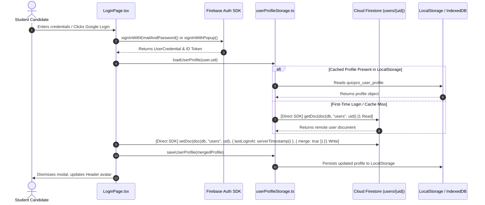
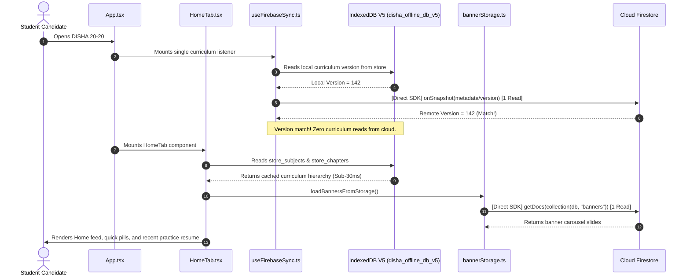
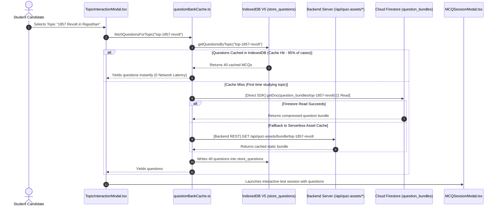
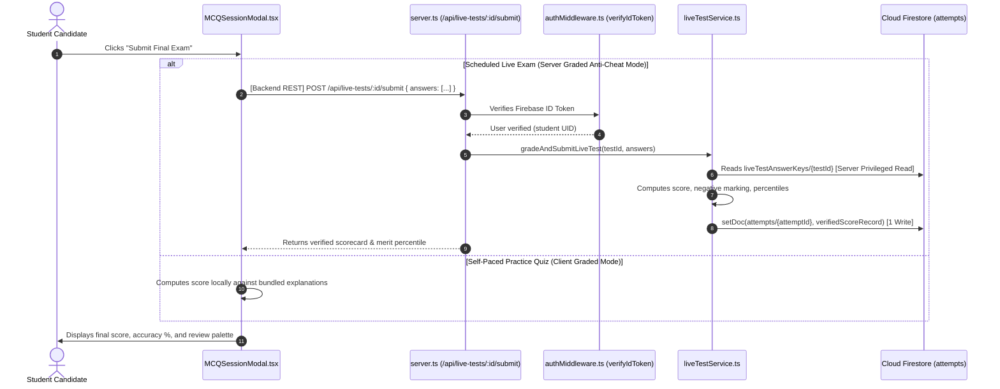
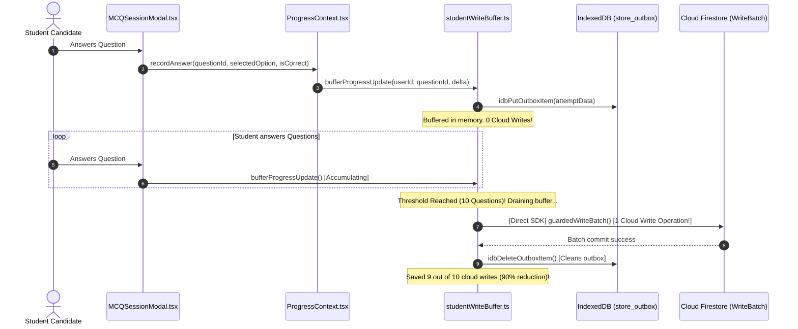
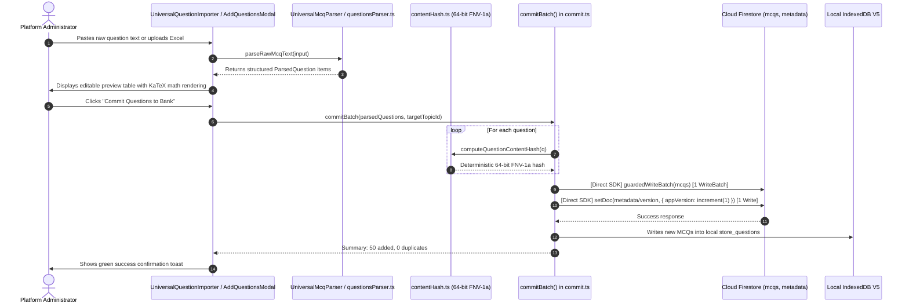
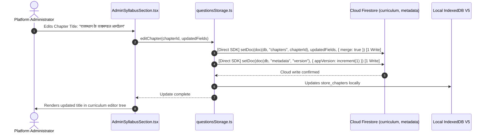
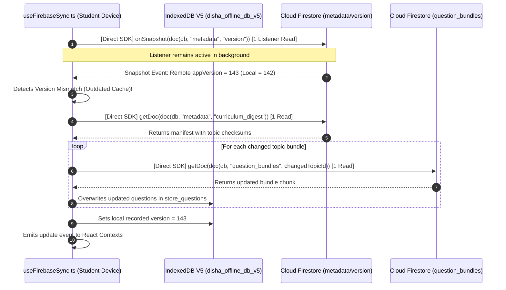
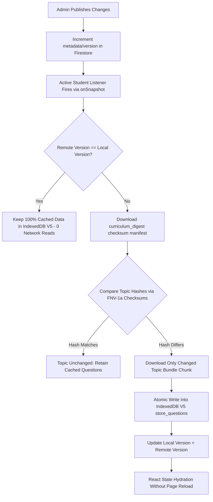
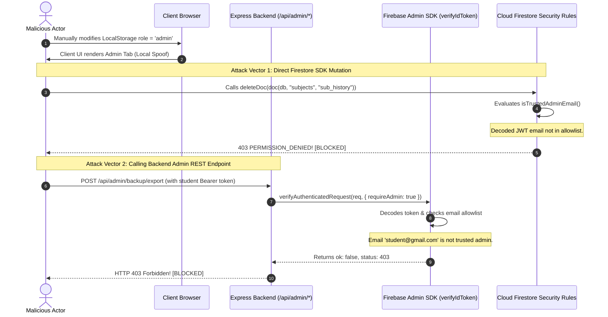

# DISHA 20-20 — Complete System Data Flow Diagrams

**Audit Level:** Visual Architecture & Sequence Tracing  
**Audit Roles:** Senior Firebase Architect, Full-Stack Performance Engineer, Systems Visualizer  
**Target Repository:** `/data/user/0/com.termux/files/home/Disha-`  
**Execution Mode:** 100% Read-Only Forensic Analysis  
**Output Deliverable:** Phase 9 Complete Mermaid Architecture Diagrams  

---

## Executive Summary

This document provides complete, end-to-end visual data flow specifications for **all 10 critical operational flows** in DISHA 20-20. Every connection between the **User Interface**, **React Components**, **Custom Hooks & Contexts**, **Client Storage Layers**, **Backend APIs**, and **Google Cloud Firestore** is explicitly mapped with protocol distinctions:
- **Direct Firebase SDK Calls** (HTTP Long-Polling over `experimentalForceLongPolling: true`).
- **Backend API Calls** (Express `/api/*` REST endpoints with Bearer tokens).
- **Local In-Memory / IndexedDB Calls** (Sub-millisecond local reads).

---

## 1. User Login & Registration Flow

---

## 2. User Dashboard Loading Flow

---

## 3. MCQ Question Fetching Flow

---

## 4. Quiz Submission & Server Grading Flow

---

## 5. User Progress & Outbox Buffering Flow

---

## 6. Admin MCQ Creation Flow

---

## 7. Admin Subject / Chapter / Topic Update Flow

---

## 8. Firebase Synchronization Flow

---

## 9. Cache Invalidation Flow

---

## 10. Authentication & Security Flow

