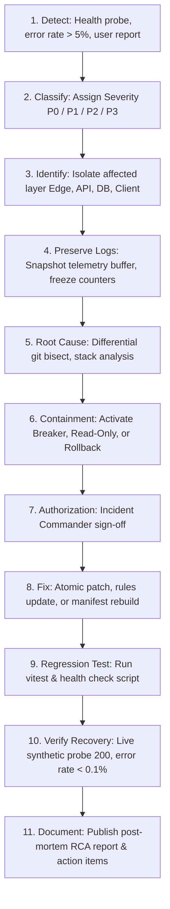

# DISHA 20-20 — Phase 11: Production Incident Response Playbook

**Version:** 1.0.0  
**Effective Date:** November 15, 2026  
**Auditor & Author:** AntiGem Autonomous Production Auditor (Jarvis Delegated Sub-Agent)  
**Target Application:** DISHA 20-20 Production (`https://disha-2020.vercel.app`)  
**Scope:** Client PWA, Vercel Edge/Serverless, Cloud Firestore, Firebase Authentication  
**Status:** **ACTIVE / STANDARD OPERATING PROCEDURE**

---

## 1. Purpose & Incident Management Principles

This playbook defines the standardized **11-Step Incident Response Workflow** for DISHA 20-20. The primary objectives during an operational incident are:
1. **Preserve Student Experience:** Maintain ongoing practice exams and preserve student study data without loss.
2. **Deterministic Containment:** Halt cascading failures (such as quota drain or cache corruption) before taking destructive actions.
3. **Zero-Secret Compliance:** Never dump raw credentials, API keys, or private user emails into incident communication channels.
4. **Authorized Remediation:** Require explicit secondary authorization before any database rollback or state purge.

---

## 2. The 11-Step Incident Response Workflow

---

## 3. Detailed Step-by-Step Execution Guide

### Step 1: Detect
* **Signals:**
  * Automated health probe (`scripts/run_production_health_check.ts`) reports non-200 or timeout.
  * `productionMonitor` registers error rate $> 2.0\%$ (HIGH) or $> 5.0\%$ (CRITICAL).
  * Vercel runtime logs report unhandled serverless exceptions.
  * Firebase quota counter exceeds 16,000 writes or 40,000 reads.

### Step 2: Classify
Assign incident priority according to user impact:
* **P0 — Critical Outage:** Total application inaccessibility, authentication dead, or continuous Firestore quota rejection. Response SLA: **$< 15$ minutes**.
* **P1 — Major Degradation:** Core feature broken (e.g. Mock test submission failing, PYQ vault unreadable), but static pages accessible. Response SLA: **$< 1$ hour**.
* **P2 — Minor Impairment:** Non-critical feature impaired (e.g. British audio TTS pronunciation proxy failing, dark mode toggle flicker). Response SLA: **$< 8$ hours**.
* **P3 — Trivial / Cosmetic:** Visual alignment defect, minor typo in question explanation. Response SLA: **$< 48$ hours**.

### Step 3: Identify
Determine the exact failure boundary:
* **Layer 1: CDN / DNS / Edge:** Is `disha-2020.vercel.app` reachable? Is SSL certificate valid?
* **Layer 2: Serverless Functions (`api/index.js`):** Does `/api/health` return HTTP 200 with `firebaseAdmin: true`?
* **Layer 3: Cloud Firestore / Firebase Auth:** Is quota exhausted? Are security rules rejecting valid tokens?
* **Layer 4: Client PWA / Service Worker:** Is stale JavaScript bundle crashing after a recent deployment?

### Step 4: Preserve Logs
Before restarting processes or clearing caches:
1. Export client telemetry buffer via `productionMonitor.getMonitoringSummary()`.
2. Capture Vercel serverless logs: `npx vercel logs --prod` or inspect runtime logs via Vercel MCP.
3. Record current Firestore quota summary from `quotaTracker.getQuotaSummary()`.
4. Export question collection metadata snapshot.

### Step 5: Root Cause Analysis (RCA)
1. Perform git differential analysis against the last known stable commit: `git log -p -n 3`.
2. Inspect sanitized error stack traces from `productionMonitor`.
3. Check for external API dependency outages (Google Cloud, Cashfree, Vercel Edge).

### Step 6: Containment
Prevent further damage immediately:
* **If Database Quota Draining:** Trigger Circuit Breaker in `quotaTracker.ts` to halt all cloud writes; client switches to local IndexedDB.
* **If Corrupt Frontend Deployment:** Execute instant zero-downtime rollback in Vercel to previous deployment ID (e.g. `dpl_EtpvaiQNugszhko25dangPYZezve`).
* **If Broken Security Rules:** Deploy emergency baseline `firestore.rules`.

### Step 7: Authorization
* Any action that alters production data, executes a database restore, or rolls back code requires explicit approval from the **Incident Commander** (Tech Lead or Designated Admin).
* No destructive or automatic data purges may be initiated without secondary confirmation.

### Step 8: Fix
* Implement the targeted atomic patch on a hotfix branch (`hotfix/incident-YYYYMMDD`).
* Avoid bundling unrelated refactoring or dependency upgrades into the emergency hotfix.
* Run code linter: `pnpm run lint` and build check: `pnpm run build`.

### Step 9: Regression Testing
* Execute the full test suite: `pnpm test` (All 89+ tests must pass).
* Execute the automated production health check: `npx tsx scripts/run_production_health_check.ts`.
* Verify quota safety and idempotent operation deduplication.

### Step 10: Verify Recovery
1. Probe live production endpoints: `/`, `/api/health`, `/robots.txt`, `/sitemap.xml`.
2. Monitor real-time error rate via `productionMonitor` for 15 minutes; ensure error rate remains $< 0.10\%$.
3. Conduct 1 end-to-end student test journey (login $\rightarrow$ topic quiz $\rightarrow$ submit $\rightarrow$ review).

### Step 11: Document
* Author a post-mortem report and store in `reports/incident_YYYYMMDD_postmortem.md`.
* Include: Incident timeline, root cause, impact radius, time to resolve (TTR), and preventive hardening items.

---

## 4. Operational Runbooks for Specific Production Incidents

### Runbook A: Cloud Firestore Quota Near-Exhaustion (Spark Tier)
* **Trigger:** Daily writes $> 16,000$ or reads $> 40,000$.
* **Containment:**
  1. Open Admin Panel $\rightarrow$ **Production Stability & Monitoring**.
  2. Enable "Cloud Sync Pause" or verify `PROACTIVE_WRITE_BREAKER_THRESHOLD` engaged.
  3. All student exam submissions automatically buffer in IndexedDB `pendingWritesQueue`.
* **Resolution:**
  1. Identify rogue write loops (e.g., uncontrolled progress updates on every tick).
  2. Allow daily quota to reset at Pacific Midnight (`America/Los_Angeles`).
  3. Drain pending queues smoothly using chunked batches (max 500 ops).

### Runbook B: Client-Side Whiteout or Chunk Loading Failure
* **Trigger:** React boundary error caught or chunk loading failure following a deployment.
* **Containment:**
  1. The student is presented with the `AppErrorBoundary` fallback card.
  2. The student clicks "Clear Local Cache & Return Home".
* **Resolution:**
  1. If widespread, verify `vite.config.ts` chunk hashing and Vercel cache headers (`Cache-Control: public, max-age=0, must-revalidate` for `index.html`).
  2. Trigger Vercel cache purge and redeploy clean assets.

### Runbook C: Google Authentication Domain Mismatch
* **Trigger:** Error code `auth/unauthorized-domain` in `LoginPage.tsx`.
* **Containment:** Telemetry alerts administrator with the unrecognized hostname.
* **Resolution:**
  1. Open Firebase Console $\rightarrow$ **Authentication** $\rightarrow$ **Settings** $\rightarrow$ **Authorized domains**.
  2. Add the custom domain or Vercel alias (e.g. `disha-2020.vercel.app`).
  3. Changes take effect globally within 120 seconds.

### Runbook D: Corrupt Question Record or Missing Fields
* **Trigger:** Question displays without options or unparseable JSON in curriculum tree.
* **Containment:** The question parser isolates the bad item and excludes it from the active session.
* **Resolution:**
  1. Open Admin Panel $\rightarrow$ **Question Report Desk**.
  2. Edit or delete the malformed question.
  3. Re-publish curriculum snapshot (`snapshotVersion` increments from `v1` to `v2`).

---

## 5. Incident Command Roles & Responsibilities

| Role | Responsibility | Authority |
|---|---|---|
| **Incident Commander (IC)** | Leads triage, determines severity, authorizes rollbacks or hotfixes | Final decision authority |
| **Technical Lead** | Performs root cause analysis, writes hotfix code, executes tests | Codebase modification |
| **Quality & Communications Lead** | Verifies recovery, drafts post-mortem, communicates status to users | Telemetry & reporting |
