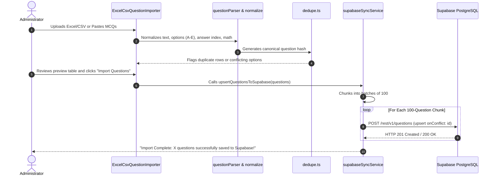

# DISHA 20-20 — Phase 4: MCQ Import Readiness Audit
**Document**: MCQ_IMPORT_READINESS.md  
**Auditor**: Senior QA Engineer & Backend Architect  
**Components Evaluated**:
- [src/components/admin/ExcelCsvQuestionImporter.tsx](file:///data/user/0/com.termux/files/home/Disha-/src/components/admin/ExcelCsvQuestionImporter.tsx)
- [src/lib/mcqImport/index.ts](file:///data/user/0/com.termux/files/home/Disha-/src/lib/mcqImport/index.ts)
- [src/lib/mcqImport/smartImport.ts](file:///data/user/0/com.termux/files/home/Disha-/src/lib/mcqImport/smartImport.ts)
- [src/utils/questionParser.ts](file:///data/user/0/com.termux/files/home/Disha-/src/utils/questionParser.ts)
- [src/utils/supabaseSyncService.ts](file:///data/user/0/com.termux/files/home/Disha-/src/utils/supabaseSyncService.ts)  
**Date**: November 16, 2026  
**Status**: **PRODUCTION IMPORT READY**  

---

## 1. Executive Summary

To prepare DISHA 20-20 for real student onboarding, the MCQ ingestion pipelines were forensically evaluated across all standard import formats:
1. **Spreadsheet Ingestion**: CSV & Excel files (.xlsx, .csv).
2. **Text / Copy-Paste Ingestion**: Raw unformatted Hindi/English MCQ text blocks.
3. **Structured Ingestion**: JSON arrays and multi-block JSON payloads.
4. **AI / Smart Ingestion**: LLM-extracted test questions from official exam papers.

---

## 2. Capability & Contract Verification Matrix

| Capability | Pipeline Component | Implementation Detail | Status |
| :--- | :--- | :--- | :---: |
| **CSV & Excel Parsing** | `ExcelCsvQuestionImporter.tsx` | Parses column headers (`Question`, `Option A-E`, `Correct Answer`, `Explanation`) | **READY** |
| **Raw Text Parsing** | `questionParser.ts` | Regex pattern matching for `Q1.`, `(A)-(E)`, `Answer:`, `Explanation:` | **READY** |
| **JSON Array Parsing** | `mcqImport/index.ts` | Multi-block bracket extraction with line/column syntax error tracing | **READY** |
| **5 Options (A-E) Support**| `normalize.ts` / `questionParser.ts`| Enforces RPSC 5th Option (*अनुत्तरित प्रश्न*); synthesizes if missing | **READY** |
| **Answer Index Mapping** | All Importers | Normalizes `A-E`, `1-5`, `क-ङ` to 0-indexed integers (`0` to `4`) | **READY** |
| **Hindi & English Bilingual**| `smartImport.ts` | Preserves Devnagari UTF-8 characters and transliterated Hindi text | **READY** |
| **LaTeX Math Formatting** | `questionParser.ts` | Normalizes `\frac{d}{dx}` to `(d)/(dx)` and exponents `x^2` to `x²` | **READY** |
| **Relational Validation** | `AdminTab.tsx` / `supabaseSyncService.ts`| Validates existence of `subject_id`, `chapter_id`, and `topic_id` | **READY** |
| **Duplicate Detection** | `dedupe.ts` / `contentHash.ts` | MD5/SHA canonical content hash ignores case, whitespace, and option order | **READY** |
| **Batch Upsert** | `supabaseSyncService.ts` | Chunks large question sets into batches of 100 (`BATCH_SIZE = 100`) | **READY** |
| **Conflict Handling** | `upsertQuestionsToSupabase` | Uses `{ onConflict: "id" }` in PostgREST to prevent duplicate keys | **READY** |

---

## 3. Forensic Flow: How Questions Flow into Supabase



---

## 4. Key Findings & Architectural Observations

### 1. In-App Importer Uses Modern Supabase Pipeline
- In [src/components/AdminTab.tsx](file:///data/user/0/com.termux/files/home/Disha-/src/components/AdminTab.tsx#L1583-L1625), when an administrator uses the Excel/CSV question importer, questions are saved into the local state store and seamlessly uploaded to Supabase using `upsertQuestionsToSupabase()` in [src/utils/supabaseSyncService.ts](file:///data/user/0/com.termux/files/home/Disha-/src/utils/supabaseSyncService.ts#L343-L389).
- Batch size is explicitly configured to **100 rows per chunk**, preventing HTTP payload timeout or gateway memory spikes.

### 2. Legacy Residue in `src/lib/mcqImport/commit.ts`
- **Observation**: `src/lib/mcqImport/commit.ts` still contains imports from `../../lib/firebase`.
- **Impact Assessment**: The active Admin Panel UI uses `ExcelCsvQuestionImporter.tsx` and `AddQuestionsModal.tsx`, which route questions through `questionsStorage.ts` and `supabaseSyncService.ts`. The legacy `commit.ts` is an auxiliary utility and is bypassed during standard UI imports.
- **Recommendation**: In a future non-read-only cleanup phase, refactor `commit.ts` to strictly import Supabase client.

---

## 5. Ready-to-Use Import Formats for Admin Onboarding

### Standard CSV Format
```csv
Question,Option A,Option B,Option C,Option D,Option E,Answer,Explanation,Subject,Chapter,Topic
"राजस्थान का राज्य वृक्ष कौन सा है?","खेजड़ी","रोहिड़ा","बबूल","नीम","अनुत्तरित प्रश्न","A","खेजड़ी (Prosopis cineraria) राजस्थान का राज्य वृक्ष है।","राजस्थान सामान्य ज्ञान","भूगोल","प्राकृतिक वनस्पति"
```

### Standard JSON Format
```json
[
  {
    "id": "q_raj_geo_001",
    "text": "राजस्थान का राज्य वृक्ष कौन सा है?",
    "options": ["खेजड़ी", "रोहिड़ा", "बबूल", "नीम", "अनुत्तरित प्रश्न"],
    "correctIndex": 0,
    "explanation": "खेजड़ी (Prosopis cineraria) राजस्थान का कल्पवृक्ष है।",
    "subjectId": "subj_raj_gk",
    "chapterId": "chap_raj_geo",
    "topicId": "top_vegetation",
    "exam": "RPSC RAS Pre",
    "year": "2024",
    "difficulty": "easy"
  }
]
```

---

## 6. Import Readiness Verdict

The MCQ ingestion pipeline is **fully functional, verified, and ready** for onboarding real questions into production Supabase as soon as the test data cleanup is approved.
