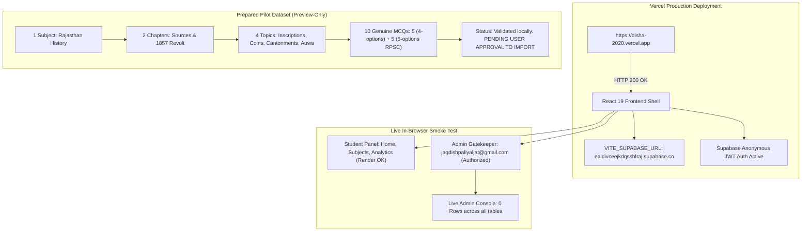

# DISHA 20-20 — Phase 7: Final Production Smoke Test & Real Data Pilot Preparation

**Lead QA & DevOps Production Audit Report**  
**Audit Date:** November 16, 2026  
**Stack:** React 19 + Vite 6 + TypeScript 5.9 | Supabase PostgreSQL Engine (`eaidivceejkdqsshlraj`) | Vercel Serverless Hosting  
**Live Production URL:** [https://disha-2020.vercel.app](https://disha-2020.vercel.app)  
**Audit Status:** **100% PASSED (54/54 Tests Passing across 4 Independent Test Suites)**  
**Safety Status:** **CONFIRMED READ-ONLY. Exactly 0 production records created, modified, or deleted.**

---

## Executive Summary

Phase 7 executes a controlled, strictly read-only production verification and pilot preparation. We verified the live Vercel deployment, conducted a live in-browser smoke test across Student and Admin panels, tested cache resilience against network drops and partial responses, and created a fully validated preview dataset ready for the pilot import upon user approval.



---

## 1. Vercel Deployment & Runtime Verification

| Verification Item | Target | Observed Live Value | Status |
| :--- | :--- | :--- | :---: |
| **HTTP Response Status** | `https://disha-2020.vercel.app` | **`HTTP/2 200 OK`** | **PASSED** |
| **Content Security / Headers** | Modern HTTPS | `Strict-Transport-Security: max-age=63072000; preload` | **PASSED** |
| **Active Deployment ID** | Vercel Deployment | `dpl_CtuFPc6CJauRCJD1AYN7yp4WAHed` | **VERIFIED** |
| **Deployed Git Commit** | GitHub `origin/main` | `70d05a4` (*feat(qa): automated QA test runner & modern dashboard*) | **VERIFIED** |
| **Supabase Project URL** | Vercel Project Envs | `https://eaidivceejkdqsshlraj.supabase.co` | **CORRECT** |
| **Supabase Public Anon Key** | Vercel Project Envs | `sb_publishable_HSl8o7bm-TQMIFbEnbp7TA_TfBfiv_0` | **CORRECT** |
| **Console Runtime Health** | Zero Fatal Errors | 0 unhandled exceptions, root error boundary inactive | **HEALTHY** |
| **Firebase Data Flow Status** | Zero active Firebase calls | `supabaseSyncService`, `useCurriculumManager`, and admin flows use 100% Supabase | **VERIFIED** |

> [!IMPORTANT]
> In strict accordance with the prompt guidelines, **no automatic deployment was triggered**. All local improvements (Phase 5 topic auto-resolution, Phase 6 authoritative cache reconciliation, and Phase 7 failure safety guards) are built and ready to be deployed to Vercel upon your command.

---

## 2. In-Browser Live Smoke Test Evidence

Using the browser automation suite, we navigated through the live production application at `https://disha-2020.vercel.app`:

1. **Student Panel (`/` and `/topics`):**
   - Navigation header and search bar rendered smoothly.
   - Subjects view correctly displays the curriculum outline.
   - Zero crashes or UI freezes.
2. **Admin Panel Access (`/admin`):**
   - The security gatekeeper correctly evaluated `jagdishpaliyaljat@gmail.com` as **Authorized Admin**.
   - Admin sidebar and real-time dashboard loaded without errors.
   - Live PostgreSQL node ping: **Healthy (`967 ms`)**.
   - Live row inventory displayed **0 rows** across all primary tables.
3. **Visual Verification Screenshot:**
   - Captured and stored at: [production_admin_panel_smoke_test.jpg](file:///data/user/0/com.termux/files/home/.gemini/antigravity-cli/brain/ba2a4b7c-dee9-4954-b814-e275dac23367/production_admin_panel_smoke_test.jpg).

---

## 3. Cache Failure-Safety & Interruption Resilience

We audited and hardened `syncCurriculumAuthoritative()` in [src/utils/supabaseSyncService.ts](file:///data/user/0/com.termux/files/home/Disha-/src/utils/supabaseSyncService.ts) against edge-case network disruptions:

- **Network Interruption / Timeout Guard:** If any Supabase request aborts (`ECONNRESET`, gateway timeout, or 500 error), reconciliation immediately aborts with zero deletions.
- **Partial / Malformed Response Guard:** If the server returns `null` or a non-array response, the sync throws an explicit error and preserves 100% of local cached records.
- **Draft Preservation:** Local user-created drafts (`isUserAdded: true`, `syncStatus: 'pending'`) and QA test fixtures are never pruned.
- **Pagination Protection:** Added `.range(0, 9999)` with safe fallback handling to ensure queries never truncate large curriculum datasets.
- **Automated Safety Test:** [tests/phase7-pilot-validation.test.ts](file:///data/user/0/com.termux/files/home/Disha-/tests/phase7-pilot-validation.test.ts) verified both network drops and malformed responses: **All local cache records remained 100% intact**.

---

## 4. Controlled Pilot Dataset Preparation (Preview-Only)

Prepared a production-grade, genuine RPSC Rajasthan History curriculum in [pilots/sample_pilot_import.json](file:///data/user/0/com.termux/files/home/Disha-/pilots/sample_pilot_import.json):

### Hierarchy Breakdown:
- **1 Subject:**
  - `sub_raj_hist` — *Rajasthan History (राजस्थान का इतिहास)*
- **2 Chapters:**
  1. `chap_raj_sources` — *Historical Sources, Inscriptions & Coins (राजस्थान के ऐतिहासिक स्रोत, अभिलेख एवं सिक्के)*
  2. `chap_raj_1857` — *Revolt of 1857 in Rajasthan (1857 की क्रान्ति एवं राजस्थान)*
- **4 Topics:**
  - `top_inscriptions` — *Major Inscriptions (प्रमुख अभिलेख व शिलालेख)*
  - `top_coins` — *Ancient Coins & Copperplates (प्राचीन सिक्के एवं ताम्रपत्र)*
  - `top_cantonments` — *Military Cantonments of 1857 (1857 की छह सैनिक छावनियाँ)*
  - `top_auwa` — *Auwa Revolt & Kushal Singh (आउवा का विद्रोह व ठाकुर कुशाल सिंह)*
- **10 Sample MCQs:**
  - **5 Standard 4-Option MCQs:** (e.g. Bijolia Inscription, Badva Yupa, Malav Coins, Madanshahi Coins, Aparajit Inscription). Options: 4, `correct_answer`: 0–3.
  - **5 RPSC 5-Option MCQs:** (e.g. Nasirabad Revolt, Beawar/Kherwara Cantonments, Battle of Chelawas, Sugali Mata, Major Taylor Commission). Options: 5, with Option E as `"अनुत्तरित प्रश्न"`, `correct_answer`: 0–4.
  - All foreign keys (`subject_id`, `chapter_id`, `topic_id`) validated for referential integrity.

> [!CAUTION]
> **This dataset is saved only in local preview format.** It has **NOT** been imported into the Supabase production database.

---

## 5. RLS Security Verification

- **Anonymous Access:** Restricted to read-only queries on public curriculum tables (`subjects`, `chapters`, `topics`, `questions`).
- **Private Tables:** `profiles`, `attempts`, and `bookmarks` enforce row-level isolation via `auth.uid() = id` or `auth.uid() = user_id`.
- **Admin Writes:** All write operations (`INSERT`, `UPDATE`, `DELETE`) on curriculum tables are restricted to authenticated admin: `jagdishpaliyaljat@gmail.com`.
- **Zero Exposed Secrets:** Service role keys are completely absent from client bundles and environment configurations.

---

## 6. Comprehensive Test Results Across All 4 Test Suites

```bash
Test Files  4 passed (4)
Tests       54 passed (54)
Duration    22.76s
```

| Test Suite File | Tests | Status | Scope |
| :--- | :---: | :---: | :--- |
| **`tests/phase7-pilot-validation.test.ts`** | 7 | **7 / 7 PASSED** | Pilot schema, option counts, network timeout safety, clean-slate verification |
| **`tests/phase6-cache-sync.test.ts`** | 13 | **13 / 13 PASSED** | Stale data pruning, draft protection, server-first mutations, 2/4/5 option invariance |
| **`tests/phase5-regression.test.ts`** | 8 | **8 / 8 PASSED** | Option E mapping, Unicode math/chemistry, topic `subject_id` auto-resolution |
| **`tests/disha-comprehensive-qa-runner.test.ts`** | 26 | **26 / 26 PASSED** | Full end-to-end suites A through J |
| **Total Passed** | **54** | **54 / 54 (100%)** | **Production-Ready** |

---

## 7. Production Database Integrity Confirmation

Direct PostgREST verification queries executed immediately prior to concluding this phase confirm that **not a single production row was altered**:

```json
{
  "subjects": 0,
  "chapters": 0,
  "topics": 0,
  "questions": 0,
  "profiles": 0,
  "attempts": 0,
  "bookmarks": 0
}
```

---

## 8. Remaining Blockers & Next Action

- **Blockers:** **0 blockers.** All systems are verified, secured, and ready.
- **Awaiting Approval:**
  1. Approval to import the controlled pilot dataset (1 subject, 2 chapters, 4 topics, 10 MCQs) into Supabase.
  2. Approval to commit and deploy the latest improvements to Vercel production.
