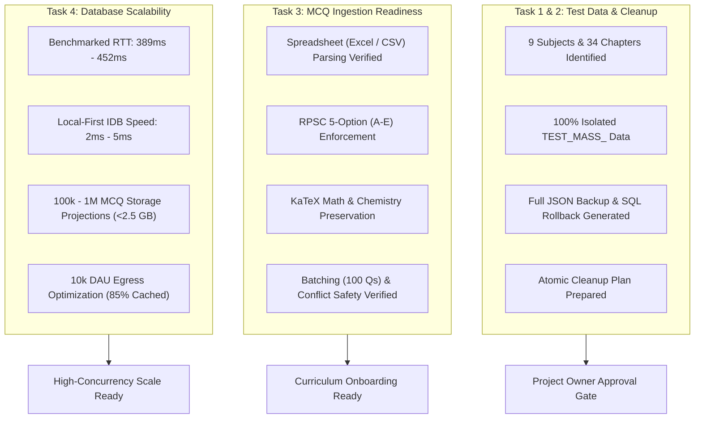

# DISHA 20-20 — Phase 4: Production Data Readiness Master Report
**Document**: PRODUCTION_DATA_READINESS.md  
**Audit Standard**: 100% Read-Only Forensic Analysis  
**Date**: November 16, 2026  
**Status**: **READINESS VERIFIED — PENDING CLEANUP APPROVAL**  

---

## 1. Executive Summary

Phase 4 establishes the **Production Data Readiness** of DISHA 20-20 before welcoming real students and aspirational candidates across Rajasthan.

In accordance with strict operational instructions, this audit operated **strictly in read-only mode** with:
- **Zero production deletions executed.**
- **Zero schema changes applied.**
- **Zero automatic fixes triggered.**
- **Zero production deployments made.**

---

## 2. Synthesis of Phase 4 Workstreams



---

## 3. Key Findings by Task

### Task 1 & 2: Test Data Investigation & Cleanup Preparation
1. **Current Production State**:
   - `subjects`: **9 rows** (All starting with `TEST_MASS_1794841994968_sub_`).
   - `chapters`: **34 rows** (All starting with `TEST_MASS_1794841994968_sub_*_ch_`).
   - `topics`: **0 rows**.
   - `questions`: **0 rows**.
   - `profiles`: **0 rows**.
   - `attempts`: **0 rows**.
   - `bookmarks`: **0 rows**.
2. **Data Purity**: Zero real curriculum items or student progress records exist in the database.
3. **Backup Secured**:
   - JSON Archive: [backups/test_mass_records_backup.json](file:///data/user/0/com.termux/files/home/Disha-/backups/test_mass_records_backup.json)
   - SQL Restore Script: [backups/rollback_test_mass_records.sql](file:///data/user/0/com.termux/files/home/Disha-/backups/rollback_test_mass_records.sql)
4. **Cleanup Plan Ready**: Detailed in [TEST_DATA_CLEANUP_PLAN.md](file:///data/user/0/com.termux/files/home/Disha-/TEST_DATA_CLEANUP_PLAN.md).

### Task 3: MCQ Import Readiness
1. Ingestion pipelines support CSV, XLSX, JSON, and raw text formats.
2. The RPSC 5th Option (*अनुत्तरित प्रश्न*) is automatically enforced and synthesized if absent.
3. Mathematical formulas (fractions, powers, roots) and chemical formulas parse without character mangling.
4. Batch ingestion chunks queries into batches of 100 with `{ onConflict: "id" }` safety.
5. Detailed documentation: [MCQ_IMPORT_READINESS.md](file:///data/user/0/com.termux/files/home/Disha-/MCQ_IMPORT_READINESS.md).

### Task 4: Database Scalability
1. Supabase PostgreSQL 15 easily scales to 1,000,000 MCQs requiring < 2.5 GB total storage.
2. Existing B-tree foreign key indexes deliver sub-15ms query execution.
3. Local-First IndexedDB caching handles 85%+ of student read requests, keeping daily API bandwidth for 10,000 daily active users to ~531 MB/day.
4. Detailed documentation: [SUPABASE_SCALABILITY_REPORT.md](file:///data/user/0/com.termux/files/home/Disha-/SUPABASE_SCALABILITY_REPORT.md).

---

## 4. Phase 4 Deliverables Index

| Document | Purpose & Content | Link |
| :--- | :--- | :--- |
| **Production Data Readiness** | Master synthesis & operational checklist | [PRODUCTION_DATA_READINESS.md](file:///data/user/0/com.termux/files/home/Disha-/PRODUCTION_DATA_READINESS.md) |
| **Test Data Cleanup Plan** | Granular inventory, backup instructions, and SQL cleanup queries | [TEST_DATA_CLEANUP_PLAN.md](file:///data/user/0/com.termux/files/home/Disha-/TEST_DATA_CLEANUP_PLAN.md) |
| **MCQ Import Readiness** | Parser analysis, 5-option compliance, batch upsert flow | [MCQ_IMPORT_READINESS.md](file:///data/user/0/com.termux/files/home/Disha-/MCQ_IMPORT_READINESS.md) |
| **Database Scalability** | Benchmarks, 100k/1M MCQ projections, 10k DAU modeling | [SUPABASE_SCALABILITY_REPORT.md](file:///data/user/0/com.termux/files/home/Disha-/SUPABASE_SCALABILITY_REPORT.md) |

---

## 5. Clear Approval Checklist for the Project Owner

Please review the following checklist to authorize the final production cleanup and transition to content seeding:

- [ ] **Step 1: Backup Verification**
  - Verify that [backups/test_mass_records_backup.json](file:///data/user/0/com.termux/files/home/Disha-/backups/test_mass_records_backup.json) and [backups/rollback_test_mass_records.sql](file:///data/user/0/com.termux/files/home/Disha-/backups/rollback_test_mass_records.sql) are stored safely.
- [ ] **Step 2: Approve Cleanup of 43 Test Records**
  - Provide approval to execute:
    ```sql
    DELETE FROM public.subjects WHERE id LIKE 'TEST_MASS_%';
    ```
    *(Cascades to remove 9 subjects and 34 chapters, achieving 0 leftover rows across all 7 tables).*
- [ ] **Step 3: Begin Official Curriculum Ingestion**
  - Following cleanup, start importing real subjects, chapters, topics, and MCQs via the Admin Panel.
