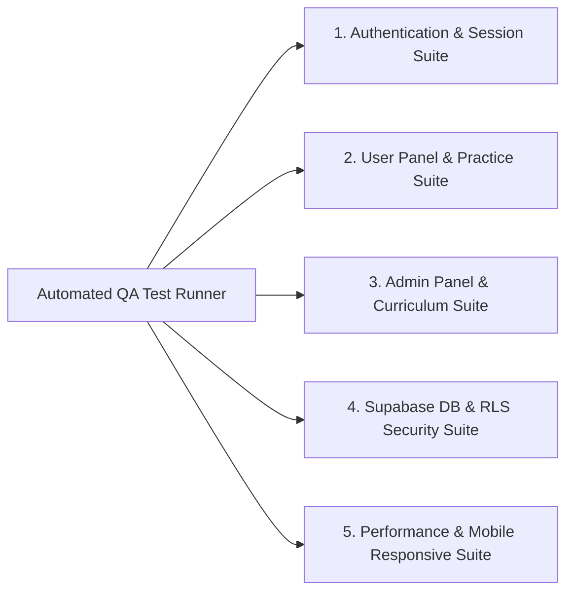

# DISHA 20-20 — Master Automated QA Test Plan

**Document Version:** 1.0.0  
**Target:** DISHA 20-20 Full Production-Grade Test Suite  
**Date:** 2026-11-16  
**Auditor:** Senior QA Automation Engineer, Security Auditor & Performance Engineer

---

## 1. Test Strategy & Objectives

The goal is to implement an automated, non-destructive, repeatable QA test harness for DISHA 20-20 covering:
1. **User Panel (Student View):** Authentication, Curriculum tree, MCQ loading, Practice session, RPSC 5th option, Scoring, Bookmarks, and Revision scheduling.
2. **Admin Panel:** Dashboard metrics, Syllabus CRUD, Question Bank (Excel/CSV/AI/HTML import & Bulk delete), Tests/PYQ, News/Banners, and Supabase live monitoring.
3. **Supabase Database & RLS Security:** Table structures, Constraints, Indexes, PostgREST queries, and Row-Level Security isolation.
4. **Performance & Reliability:** Query latency, render cycles, cache utilization, and mobile viewport responsive compliance.
5. **Regression & Safety:** 100% clean-slate test cleanup with zero impact on production data.

---

## 2. Test Execution Matrix by Module

### Module 1: Authentication & Session Management
- **TC-AUTH-01:** Google OAuth initialization passes correct `redirectTo` parameter (`https://disha-2020.vercel.app/`).
- **TC-AUTH-02:** Guest student fallback creates valid anonymous profile (`role: 'student'`) without throwing.
- **TC-AUTH-03:** Admin elevation correctly recognizes authorized admin email (`jagdishpaliyaljat@gmail.com`).
- **TC-AUTH-04:** Unauthorized non-admin accounts cannot access `/admin` or execute admin functions.
- **TC-AUTH-05:** Session persistence in `localStorage` restores authenticated session on page refresh.

### Module 2: MCQ & Practice Engine
- **TC-MCQ-01:** Loads questions filtered by `topic_id` from Supabase with verified answer keys.
- **TC-MCQ-02:** Validates MCQ data structure: question text, 4-5 options, correct index (0-4), explanation, and KaTeX math formulas.
- **TC-MCQ-03:** Practice Test session flow: answer selection, next/prev navigation, review bookmarking, instant feedback.
- **TC-MCQ-04:** RPSC 5th Option compliance: unanswered questions flagged or scored per RPSC negative marking rules.
- **TC-MCQ-05:** Test submission calculates score, accuracy percentage, time spent, and persists attempt to Supabase `public.attempts`.
- **TC-MCQ-06:** SuperMemo SM-2 Spaced Repetition: incorrect questions added to `WrongTab` with correct interval calculation.

### Module 3: Admin Panel Features
- **TC-ADM-01:** Admin Dashboard loads system health, latency ping, and PostgreSQL table row counts.
- **TC-ADM-02:** Subject Management: Create, Read, Update, and Delete subject with Supabase persistence.
- **TC-ADM-03:** Chapter & Topic Management: Create, Read, Update, and Delete with parent FK verification.
- **TC-ADM-04:** Excel / CSV Question Importer: Parses CSV files with multi-column mapping into valid question models.
- **TC-ADM-05:** Bulk Delete Tool: Accurately filters questions by subject/chapter and deletes target IDs safely.
- **TC-ADM-06:** MCQ Duplicate Scanner: Detects exact string matches and fuzzy duplicate questions.
- **TC-ADM-07:** Coaching Hierarchy & Multi-Tenant batches: Verifies gating and access control.
- **TC-ADM-08:** Backup & Restore: Generates JSON export and validates import schema integrity.

### Module 4: Supabase Database & RLS Security (Critical)
- **TC-RLS-01:** Anonymous user can SELECT from `subjects`, `chapters`, `topics`, and `questions`.
- **TC-RLS-02:** Anonymous user CANNOT INSERT or UPDATE `subjects`, `chapters`, `topics`, or `questions`.
- **TC-RLS-03:** Student user CANNOT view other students' attempts (`public.attempts`).
- **TC-RLS-04:** Student user CANNOT view other students' bookmarks (`public.bookmarks`).
- **TC-RLS-05:** Student user CANNOT execute administrative writes on curriculum tables.
- **TC-RLS-06:** Admin user (`jagdishpaliyaljat@gmail.com`) can perform full CRUD on curriculum and question tables.
- **TC-RLS-07:** Foreign key cascade verification: Deleting a subject cascades to its chapters and topics.
- **TC-RLS-08:** Zero service_role key exposure audit: Verifies build assets contain 0 service_role secrets.

### Module 5: Performance & Mobile Responsiveness
- **TC-PERF-01:** Database ping latency is within target threshold (< 1000ms).
- **TC-PERF-02:** IndexedDB local caching prevents redundant network queries on repeated tab navigation.
- **TC-PERF-03:** Admin collapsible sidebar toggles cleanly between 256px and 80px on desktop screens.
- **TC-PERF-04:** Admin mobile bottom bar provides minimum 44px tap targets and zero overlapping with student nav.
- **TC-PERF-05:** High-volume MCQ virtualized list renders 500+ questions with 0 layout shift or memory leak.

---

## 3. Test Data Safety Protocol (Zero Production Pollution)

1. **Isolated Prefixes:** All test fixtures will use dedicated prefixes:
   - Subjects: `qa-test-subj-*`
   - Chapters: `qa-test-chap-*`
   - Topics: `qa-test-top-*`
   - Questions: `qa-test-q-*`
   - Attempts: `qa-test-att-*`
2. **Guaranteed Cleanup in `finally` Blocks:** Every test creating temporary records must run an automated tear-down cleanup query.
3. **Clean-Slate Assertion:** The test suite concludes with a clean-slate query ensuring 0 `qa-test-*` records remain in the database.
4. **Never Run Drop/Truncate:** No `TRUNCATE`, `DROP TABLE`, or `CASCADE` scripts will ever be executed against production tables.

---

## 4. Test Deliverables & Execution Schedule

| Phase | Description | Deliverables |
| :--- | :--- | :--- |
| **Phase 1** | Read-Only Audit | `QA_ARCHITECTURE_REPORT.md` `SUPABASE_DATABASE_AUDIT.md` `QA_TEST_PLAN.md` |
| **Phase 2** | Test Harness Implementation | Automated test runner files under `tests/` and in-app QA component updates |
| **Phase 3** | User Panel Suite Execution | Full verification of student journeys and practice mechanics |
| **Phase 4** | Admin Panel Suite Execution | Full verification of all 10 admin management modules |
| **Phase 5** | Database & RLS Security Suite | Deep RLS isolation & privilege escalation tests |
| **Phase 6** | Performance & Regression Suite | Query latency, responsiveness & clean-slate verification |
| **Phase 7** | Final Comprehensive QA Reports | `QA_SUMMARY.md` `QA_DETAILED_REPORT.md` `SUPABASE_SECURITY_REPORT.md` `PERFORMANCE_REPORT.md` |
