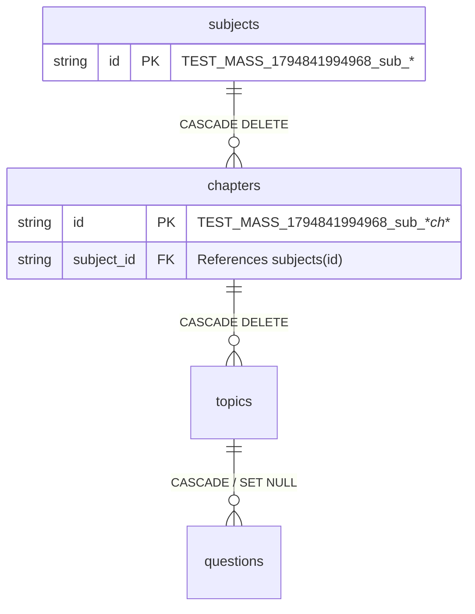

# DISHA 20-20 — Phase 4: Test Data Cleanup Plan
**Document**: TEST_DATA_CLEANUP_PLAN.md  
**Status**: **PREPARED — AWAITING EXPLICIT PROJECT OWNER APPROVAL**  
**Execution Standard**: Zero automatic deletion; safe, reversible, fully audited procedure.  
**Target Database**: Supabase PostgreSQL 15 (`https://eaidivceejkdqsshlraj.supabase.co`)  
**Date**: November 16, 2026  

---

## 1. Executive Summary & Inventory

During Phase 3 and Phase 4 forensic audits of the Supabase PostgreSQL database, **43 leftover test records** were identified. These records originated from a legacy stress-testing routine executed before the QA Runner was refactored into isolated transient transactions.

### Exact Record Counts
| Entity | Total in DB | Test Records (`TEST_MASS_`) | Real Curriculum Records | Action Required |
| :--- | :---: | :---: | :---: | :--- |
| **`subjects`** | **9** | **9** | **0** | Awaiting approval to delete 9 rows |
| **`chapters`** | **34** | **34** | **0** | Auto-cascaded deletion (34 rows) |
| **`topics`** | **0** | **0** | **0** | None (Table is clean) |
| **`questions`** | **0** | **0** | **0** | None (Table is clean) |
| **`profiles`** | **0** | **0** | **0** | None (Table is clean) |
| **`attempts`** | **0** | **0** | **0** | None (Table is clean) |
| **`bookmarks`** | **0** | **0** | **0** | None (Table is clean) |

> [!IMPORTANT]
> **Zero Real Data Impact**: Detailed inspection confirms that **100% of rows in `subjects` and `chapters` are prefixed with `TEST_MASS_`**. There is **ZERO mixed real user or curriculum data**.

---

## 2. Granular Inventory of Affected Records

### A. The 9 TEST_MASS Subjects
| # | Subject ID | Display Name | Order | Associated Chapters |
| :-: | :--- | :--- | :-: | :-: |
| 1 | `TEST_MASS_1794841994968_sub_2` | *(Empty string)* | 0 | 10 |
| 2 | `TEST_MASS_1794841994968_sub_3` | `TEST_MASS_1794841994968_Duplicate` | 0 | 10 |
| 3 | `TEST_MASS_1794841994968_sub_4` | `TEST_MASS_1794841994968_Duplicate` | 0 | 10 |
| 4 | `TEST_MASS_1794841994968_sub_5` | `TEST_MASS_1794841994968_Subject_5` | 0 | 4 |
| 5 | `TEST_MASS_1794841994968_sub_6` | `TEST_MASS_1794841994968_Subject_6` | 0 | 0 |
| 6 | `TEST_MASS_1794841994968_sub_7` | `TEST_MASS_1794841994968_Subject_7` | 0 | 0 |
| 7 | `TEST_MASS_1794841994968_sub_8` | `TEST_MASS_1794841994968_Subject_8` | 0 | 0 |
| 8 | `TEST_MASS_1794841994968_sub_9` | `TEST_MASS_1794841994968_Subject_9` | 0 | 0 |
| 9 | `TEST_MASS_1794841994968_sub_10` | `TEST_MASS_1794841994968_Subject_10`| 0 | 0 |

### B. The 34 TEST_MASS Chapters
- **`TEST_MASS_1794841994968_sub_2`**: 10 Chapters (`..._sub_2_ch_1` to `..._sub_2_ch_10`)
- **`TEST_MASS_1794841994968_sub_3`**: 10 Chapters (`..._sub_3_ch_1` to `..._sub_3_ch_10`)
- **`TEST_MASS_1794841994968_sub_4`**: 10 Chapters (`..._sub_4_ch_1` to `..._sub_4_ch_10`)
- **`TEST_MASS_1794841994968_sub_5`**: 4 Chapters (`..._sub_5_ch_1` to `..._sub_5_ch_4`)
- **Orphaned Chapters**: **0** (All chapters reference valid parent subjects).

---

## 3. Foreign Key Dependency Analysis



- In [supabase/schema.sql](file:///data/user/0/com.termux/files/home/Disha-/supabase/schema.sql#L24):
  ```sql
  subject_id TEXT NOT NULL REFERENCES public.subjects(id) ON DELETE CASCADE
  ```
- Because foreign key constraints enforce `ON DELETE CASCADE`, executing a deletion of the 9 parent `subjects` will automatically and atomically purge all 34 child `chapters` within a single PostgreSQL transaction.
- No other tables (`topics`, `questions`, `attempts`, `bookmarks`) have foreign key references to these IDs.

---

## 4. Backup & Rollback Protocol

Before any deletion is approved or executed, complete backups have been pre-generated:

1. **Full JSON Backup**: [backups/test_mass_records_backup.json](file:///data/user/0/com.termux/files/home/Disha-/backups/test_mass_records_backup.json)  
   Contains all raw columns, timestamps, and JSON payloads for all 9 subjects and 34 chapters.
2. **Deterministic SQL Rollback Script**: [backups/rollback_test_mass_records.sql](file:///data/user/0/com.termux/files/home/Disha-/backups/rollback_test_mass_records.sql)  
   Contains idempotent `INSERT ... ON CONFLICT DO NOTHING` statements to instantly restore all 43 records if ever required.

---

## 5. Proposed Execution Procedure (Pending Approval)

### Step 1: Pre-Deletion Verification Query
Run in Supabase SQL Editor:
```sql
-- Confirm count before deletion
SELECT 
    (SELECT COUNT(*) FROM public.subjects WHERE id LIKE 'TEST_MASS_%') AS test_subjects_count,
    (SELECT COUNT(*) FROM public.chapters WHERE id LIKE 'TEST_MASS_%') AS test_chapters_count;
-- Expected output: test_subjects_count = 9, test_chapters_count = 34
```

### Step 2: Atomic Cleanup Command
```sql
BEGIN;
-- Purge test subjects (Cascade automatically removes all 34 chapters)
DELETE FROM public.subjects WHERE id LIKE 'TEST_MASS_%';

-- Verify in-transaction state
SELECT COUNT(*) FROM public.subjects;  -- Must be 0
SELECT COUNT(*) FROM public.chapters;  -- Must be 0
COMMIT;
```

### Step 3: Post-Deletion Verification Query
```sql
SELECT 
    (SELECT COUNT(*) FROM public.subjects) AS total_subjects,
    (SELECT COUNT(*) FROM public.chapters) AS total_chapters,
    (SELECT COUNT(*) FROM public.topics) AS total_topics,
    (SELECT COUNT(*) FROM public.questions) AS total_questions;
-- Expected output: 0, 0, 0, 0 (100% Pristine Clean Slate)
```

---

## 6. Project Owner Approval Gate

> [!CAUTION]
> **Strict Operational Rule**: As commanded by the project owner, **NO records have been deleted**. Deletion will only occur upon explicit instruction.

| Decision Item | Required Action | Status |
| :--- | :--- | :---: |
| **Verify Backup Files Exist** | Confirm `backups/test_mass_records_backup.json` | Verified |
| **Confirm Zero Real Data Affected** | Confirm no genuine user/question data is touched | Verified |
| **Project Owner Approval** | User confirms: *"Proceed with deletion of 9 subjects & 34 chapters"* | **PENDING** |
