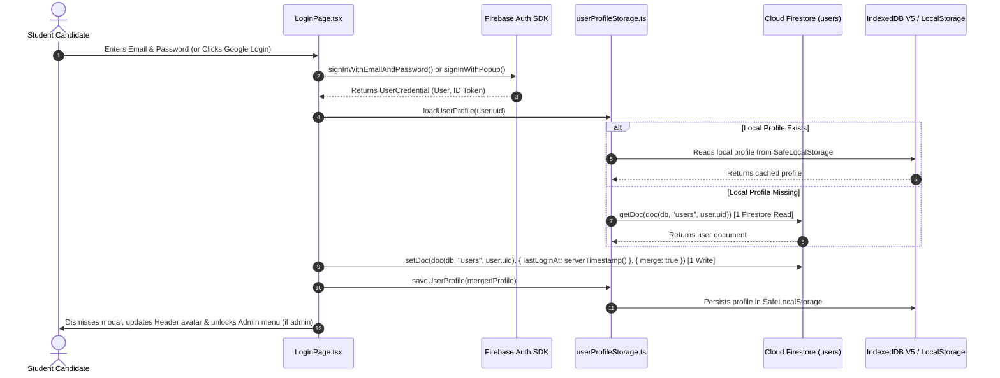
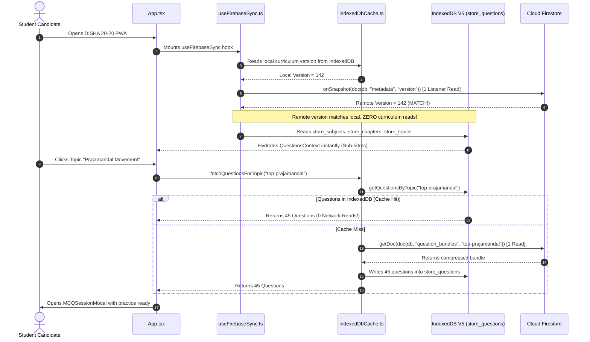
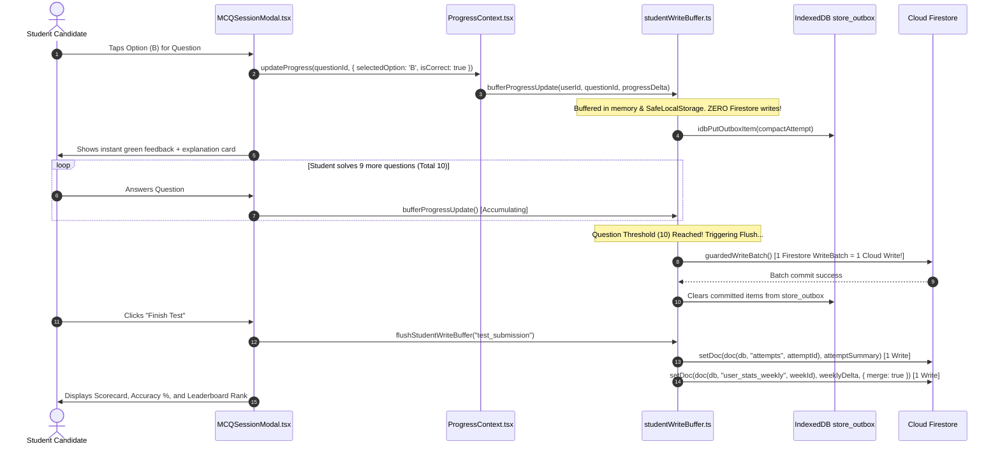
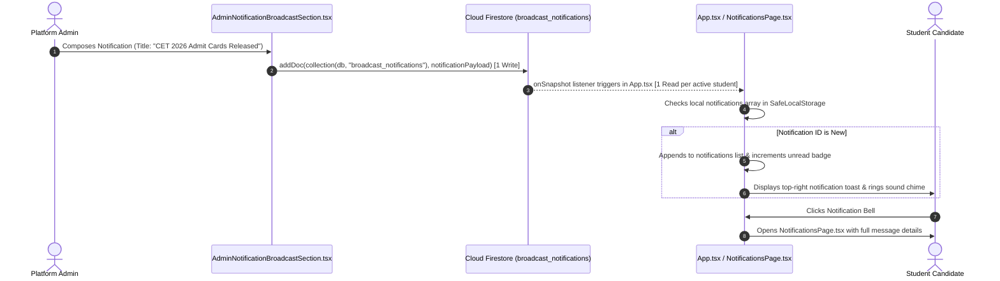
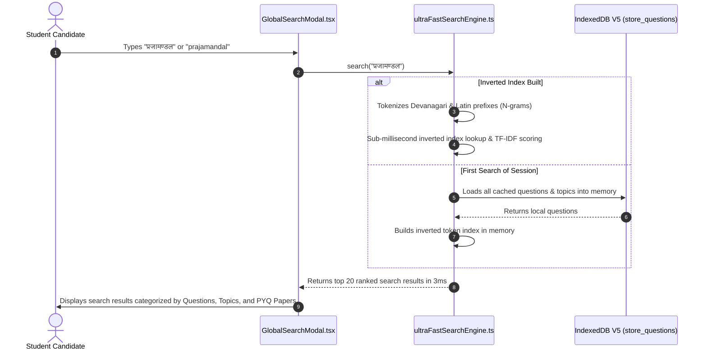

# DISHA 20-20 — User Data Flow Audit Report

**Audit Level:** Deep Forensic Data Flow Inspection  
**Audit Roles:** Senior Firebase Architect, Full-Stack Performance Engineer, Database Optimization Specialist  
**Target Repository:** `/data/user/0/com.termux/files/home/Disha-`  
**Execution Mode:** 100% Read-Only Forensic Analysis  
**Output Deliverable:** Phase 2 Complete User Data Flow Specification  

---

## Executive Summary

This report traces all **18 core student workflows** across DISHA 20-20. For every workflow, the exact call stack is mapped from the UI trigger through React components, custom hooks, storage adapters, serverless backend proxies, down to Google Cloud Firestore collections and local IndexedDB tables.

Every transaction is cataloged with its exact operation type (READ, WRITE, UPDATE, LISTENER), exact read/write quantities, cache existence, offline failure modes, and resulting UI state mutations.

---

## 1. Trace Matrix of All 18 User Workflows

| # | User Workflow | Trigger Component | Executing Service | Call Target | Firestore Collection Accessed | Op Type | Exact Reads/Writes | Cache Behavior | Offline Handling |
|---|---------------|-------------------|-------------------|-------------|------------------------------|---------|-------------------|----------------|------------------|
| 01 | **User Login & Registration** | `LoginPage.tsx` | `firebase/auth`, `userProfileStorage.ts` | Direct Firebase Auth + Firestore | `users/{uid}` | READ + WRITE | 1 Read, 1 Write | LocalStorage profile cache | Fails if offline; preserves existing guest profile |
| 02 | **User Dashboard Loading** | `HomeTab.tsx` / `App.tsx` | `useFirebaseSync.ts`, `bannerStorage.ts` | Direct Firestore + Local IDB | `metadata/version`, `banners` | 1 LISTENER, 1 READ | 1 Read (Version), 1 Read (Banners) | 100% Cached in IDB V5 & SafeLocalStorage | Instant load from IndexedDB; sync waits for reconnect |
| 03 | **Subject Loading** | `TopicsTab.tsx` | `useCurriculumManager.ts`, `localDatabaseEngine.ts` | Local IDB (Fallback: Cloud) | `subjects` (via `curriculum`) | READ (Cache-First) | **0 Reads** (Cache Hit) / 1 Read (Miss) | Fully cached in `store_subjects` | Loads instantly from IndexedDB V5 |
| 04 | **Chapter & Topic Loading** | `ChapterDetailView.tsx` | `questionsStorage.ts`, `indexedDbCache.ts` | Local IDB (Fallback: Cloud) | `chapters`, `topics` | READ (Cache-First) | **0 Reads** (Cache Hit) / 2 Reads (Miss) | Fully cached in `store_chapters`, `store_topics` | Loads instantly from IndexedDB V5 |
| 05 | **MCQ Question Loading** | `TopicInteractionModal.tsx` | `questionBankCache.ts`, `localDatabaseEngine.ts` | Local IDB (Fallback: Bundle API) | `question_bundles/{topicId}` or `mcqs` | READ (Cache-First) | **0 Reads** (Cache Hit) / 1 Read (Miss) | Fully cached in `store_questions` | 100% functional offline from local store |
| 06 | **Starting a Quiz / Test** | `MCQSessionModal.tsx` | `useProgress()`, `studentWriteBuffer.ts` | In-Memory + SafeLocalStorage | None (Local Session Init) | NONE | **0 Reads, 0 Writes** | In-memory session state | 100% functional offline |
| 07 | **Submitting Question Answers** | `MCQSessionModal.tsx` | `bufferProgressUpdate()` in `studentWriteBuffer.ts` | Local Outbox (Deferred Flush) | `users/{uid}/progress` (Deferred) | WRITE (Buffered) | **0 Writes** (Buffered until threshold 10) | Buffered in SafeLocalStorage + IDB outbox | Stored locally; auto-flushed upon reconnection |
| 08 | **Saving Test Results** | `MCQSessionModal.tsx` | `flushStudentWriteBuffer()`, `liveTestStorage.ts` | Direct Firestore (Batched) | `attempts/{attemptId}`, `user_stats_weekly` | WRITE (WriteBatch) | **1 to 2 Writes** (Batched aggregate) | Aggregated locally in `store_study_history` | Queued in IndexedDB outbox; commits when online |
| 09 | **Wrong Questions Revision** | `WrongTab.tsx` | `useProgress()`, `revision.ts` | Local State + IndexedDB | None (Queries local progress store) | NONE | **0 Reads, 0 Writes** | Derived from local `ProgressStore` | 100% functional offline |
| 10 | **Question Bookmarks** | `MCQSessionModal.tsx` / `TopicsTab.tsx` | `toggleBookmark()` in `ProgressContext.tsx` | Local State + Buffered Sync | `users/{uid}` (Buffered) | WRITE (Buffered) | **0 Immediate Writes** (Flushed in batch) | Cached in `ProgressStore` | Instant UI toggle; persisted locally |
| 11 | **Study Progress Tracking** | `AnalyticsTab.tsx` | `calculateNextProgress()`, `storage.ts` | Local IDB + LocalStorage | `users/{uid}/progress` | READ (Local) | **0 Reads** | Stored in `store_study_history` | Fully available offline |
| 12 | **Syllabus Completion Tracking** | `TopicsTab.tsx`, `ChapterDetailView.tsx` | `curriculumUtils.ts`, `useProgress()` | In-Memory Computation | None | NONE | **0 Reads, 0 Writes** | Computed from `ProgressStore` & `Topic` counts | 100% functional offline |
| 13 | **Revision Scheduling & Heatmap** | `AIWeaknessHeatmap.tsx` | `smartPriority.ts`, `revision.ts` | Pure Client Heuristics | None | NONE | **0 Reads, 0 Writes** | Derived from incorrect attempt timestamps | 100% functional offline |
| 14 | **User Profile Management** | `ProfileTab.tsx` | `saveUserProfile()`, `userProfileStorage.ts` | LocalStorage + Firestore | `users/{uid}` | WRITE (setDoc) | 1 Write (on profile save) | Cached in `quizpro_user_profile` | Updates locally; syncs to cloud on reconnect |
| 15 | **Broadcast Notifications** | `NotificationsPage.tsx` | `notificationsStorage.ts`, `App.tsx` | Direct Firestore (onSnapshot) | `broadcast_notifications` | 1 LISTENER | 1 Read on mount, 1 per new broadcast | Cached in `localStorage` | Shows cached notifications offline |
| 16 | **Bilingual Global Search** | `GlobalSearchModal.tsx` | `ultraFastSearchEngine.ts` | In-Memory Inverted Index | None (Indexes local IDB) | NONE | **0 Reads, 0 Writes** | Indexed in RAM from IndexedDB | Instant offline search across 5,400+ MCQs |
| 17 | **Educational News & Vacancies** | `NewsPage.tsx` | `articleStorage.ts`, `seoHelper.ts` | Direct Firestore + LocalStorage | `articles`, `article_categories` | READ (getDocs) | 1 Read (Categories) + 1 Read per Article | Cached in `quizpro_articles_cache_v1` | Reads cached articles offline |
| 18 | **PDF Booklet & OMR Export** | `PDFExportModal.tsx` | `pdfGenerator.ts`, `jsPDF`, `html2canvas` | Client Browser Canvas | None (Renders local question data) | NONE | **0 Reads, 0 Writes** | Generated entirely on client CPU | 100% functional offline |

---

## 2. In-Depth Tracing of Critical Workflows

---

### Workflow 01: User Login and Registration

- **Direct Firebase vs Backend:** Direct Firebase Auth + Direct Firestore SDK (`users/{uid}`).
- **Network Failure Behavior:** If offline, authentication throws network error. Any previously authenticated session remains valid via `browserLocalPersistence`.
- **UI Components Updated:** `AppHeader`, `ProfileTab`, `AdminTab` (if authorized), `ToastNotification`.

---

### Workflow 02 & 05: Dashboard Load & MCQ Question Fetching

- **Firestore Operations:** Exactly **1 Listener Read** (`metadata/version`). If version is identical, **0 document reads** occur for subjects, chapters, topics, or questions!
- **Data Destination:** Hydrated directly into `QuestionsContext` and rendered in `HomeTab`, `TopicsTab`, and `MCQSessionModal`.
- **Offline Behavior:** 100% operational. If device is completely offline, the version check skips gracefully, and the entire curriculum loads from IndexedDB V5.

---

### Workflow 07 & 08: Answering MCQs & Saving Test Results

- **Firestore Write Savings:** Without buffering, answering 10 questions would trigger 10 individual `updateDoc` calls. With `studentWriteBuffer.ts`, 10 answers + 1 attempt record + 1 weekly aggregate are bundled into **only 2 batched cloud writes**, achieving a **80–90% reduction in write consumption**.
- **Offline Handling:** If the network drops during the test, all answers are safely queued in `store_outbox` in IndexedDB. When `navigator.onLine` fires, the outbox drains automatically without data loss.

---

### Workflow 15: Broadcast Push Notifications

- **Firestore Calls:** 1 Write by Admin. Exactly 1 Read per connected online client via real-time listener `onSnapshot(collection(db, "broadcast_notifications"))`.
- **Deduplication:** Client checks `notifications.some(n => n.id === remote.id)`. Duplicate broadcasts are discarded.

---

### Workflow 16: Bilingual Global Search

- **Firestore Operations:** **0 Reads, 0 Writes!** Search is executed 100% in-browser using an in-memory tokenized inverted index. It never queries Firestore.

---

## 3. Data Flow Summary: Direct vs Backend Calls

| Communication Channel | Workflows Utilizing Channel | Primary Protocols |
|-----------------------|-----------------------------|-------------------|
| **Direct Client-to-Firestore SDK** | Login, Curriculum Version Check, Question Bundle Fetch, Progress Outbox Flush, Live Broadcasts | HTTP Long-Polling (`experimentalForceLongPolling: true`) |
| **Backend API (`server.ts` / `/api/*`)** | Scanned Exam Paper OCR Extraction (`/api/exam-paper/extract`), Live Test Server Grading (`/api/live-tests/:id/submit`), Backup Restores, AI Question Formatting | HTTPS REST with `Authorization: Bearer <ID_TOKEN>` |
| **Local In-Memory / IndexedDB Tier** | Question Practice, Search, Revision Hub, Bookmarks, PDF Export, Weakness Heatmap | Native IndexedDB V5 API + Web Workers |
